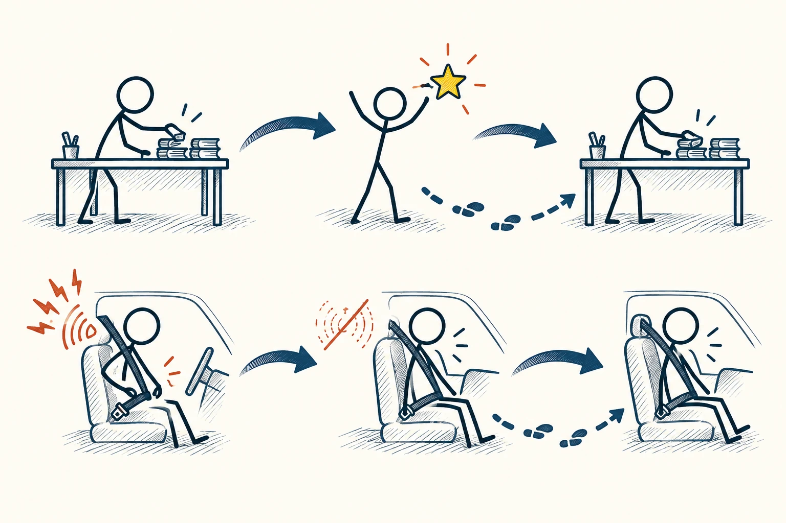
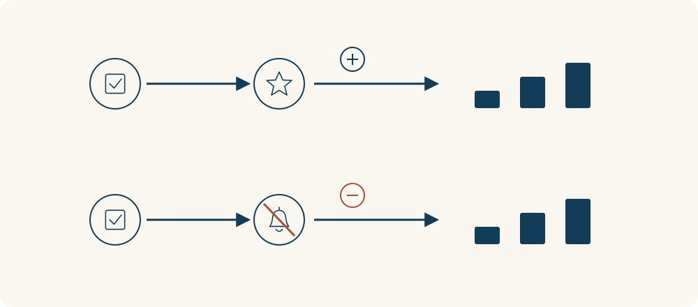

# 86 · 正强化与负强化

Positive and Negative Reinforcement · 行为与成长

> 奖励可能让行为变多，拿掉不舒服的东西，也可能让行为变多。

*配图说明：两条平行强化回路，行为都增加：上方火柴人完成整理桌面后获得小星星，下一次更愿意整理；下方火柴人系好车内安全带后刺耳提醒声波消失，下一次更愿意系带。*

## 定义

“正强化”和“负强化”很容易被误听成奖励和惩罚。先记住：两者都在增加某种行为。正，是加上某种东西；负，是拿走某种东西。强化有没有发生，要看之后的行为是不是真的更常出现，而不是只看你原本的好意。

在操作性条件作用中，正强化通过增加某种刺激、负强化通过移除某种刺激，使行为再次出现的可能性提高；惩罚则旨在减少行为。

比如完成整理后得到喜欢的反馈，之后更愿意整理，可能是正强化；系好安全带后烦人的提示音停止，因此以后更及时系好，可能是负强化。惩罚的方向则是让某种行为减少，和负强化不是一回事。

两种强化都要沿回路往后看：某个行为之后，增加了喜欢的东西，或者减少了不舒服的东西，下一次这个行为是否更容易发生？区别在后果怎么改变环境，不在于哪种听起来更严厉。

## 举个身边的例子

你想养成每天练琴的习惯，给自己安排每次练完后听一首喜欢的演出。如果这个后果让你更愿意开始，便可能起到正强化作用。只是“安排了奖励”还不算完成，得看习惯是否真的增加。

另一个例子是设备发出提示，直到你关好门才停止。如果提示音的消失让关门行为更容易再出现，这属于负强化。这里的“负”没有说行为不好，只是在描述有东西被拿走了。

*上方增加喜欢的后果，下方移除烦扰；两者都可能让行为更容易再次发生。*

## 换个场景看看

你每次在催促升级的弹窗里点“以后再说”，弹窗马上消失。如果这种轻松让你以后更习惯点它，行为就被后果带着走了，哪怕设计者原本想让你升级。

## 可以这样试

**什么时候用得上：** 培养习惯、理解产品提醒、设计学习反馈，或你发现“奖也奖了却没用”时，可以用它拆开看。

1. 先把想增加的行为写清楚，比如“练十分钟”，别只写“更自律”。
2. 检查行为之后加上或拿走了什么，以及这个后果对当事人是否真的有影响。
3. 观察一段时间的行为变化，同时留意是否出现应付、作弊或更多压力。

## 别用过头了

不是所有表扬都对所有人有用，奖励也可能让人只盯着奖品。更别为了控制别人，故意制造不适再让他通过服从换取解脱。理解机制，也要尊重边界。

## 花一分钟试试

选一个反复发生的习惯，写“发生前是什么，行为是什么，随后得到或摆脱了什么”。别急着评好坏，先看清这条链。

## 顺着看下去

- [87 · 内在动机](061.md)
- [88 · 霍桑效应](062.md)
- [77 · 反馈回路](066.md)

## 来源与延伸

- [Operant Conditioning · OpenStax Psychology 2e](https://openstax.org/books/psychology-2e/pages/6-3-operant-conditioning)

---

例子为方便理解而设置，不是真实案例报道。
