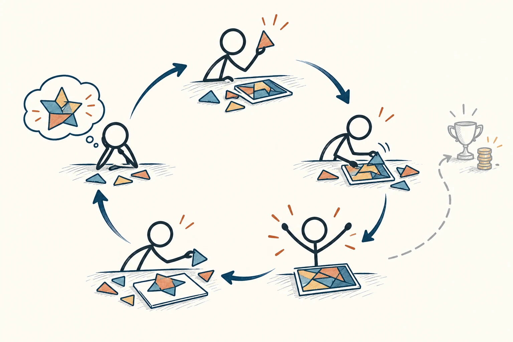

# 87 · 内在动机

Intrinsic Motivation · 行为与成长

> 有些事情你愿意做，是因为做的过程本身就让你开心。

*配图说明：活动本身的兴趣回路：火柴人专注拼几何拼图，完成后开心再主动尝试新拼图，短回路连接兴趣、投入、满足。*

## 定义

你画画时忘了时间、解开一道题觉得很满足、种花只是喜欢看它慢慢长，这些都可能带着内在动机：不是为了分数、奖金或别人点赞，而是活动本身值得投入。它解释了为什么有些事没人催，你也会想继续。

在自我决定理论中，内在动机指为了活动本身的兴趣与满足而参与活动，区别于为了可分离的外部结果而行动。

要支持这种动力，可以给自己一点选择、让进步看得见，也和支持你的人保持连接。相关理论把自主、胜任和联结看作重要需要。换成大白话，就是“我能作一点主”“我做得到、也在进步”“这里有人理解我”。

## 举个身边的例子

你本来喜欢拍照，后来开始经营账号，每次出门只想哪种画面点赞更多。慢慢地，拿起相机就想到数据和比较，原先观察光影的乐趣反而少了。

可以留一部分时间，只拍自己想拍的东西，不必发布；把练习目标放在某项技巧进步，而不是每张都要赢。你不需要讨厌外界认可，只是给活动本身留一点呼吸空间，别让所有乐趣都被成绩接管。

## 换个场景看看

孩子喜欢画画，你每次都追问比赛名次，画画可能渐渐只剩“交成绩”。试着问他画了什么、最喜欢哪部分，关注探索过程，而不只盯结果。

## 可以这样试

**什么时候用得上：** 学习难以坚持、爱好变成负担，或你想帮助别人更主动投入时，可以从这里看。

1. 问问自己，这件事里面有没有哪一小部分，即使没人知道也愿意做。
2. 给它留适度选择和可以完成的小挑战，看到进步后再加一点难度。
3. 寻找支持与共同兴趣，减少不必要的排名、催促和被监视感。

## 别用过头了

有内在兴趣不代表不用休息，也不代表别人可以不付合理报酬。枯燥但必要的任务，仍需要公平安排，不能只靠“你要热爱”来解决。

## 花一分钟试试

为一个原本喜欢、现在有压力的活动，安排二十分钟“没有评分”的时间。只做你感兴趣的一小部分，看看感受有什么不同。

## 顺着看下去

- [86 · 正强化与负强化](060.md)
- [91 · 马斯洛需求层次理论](070.md)
- [93 · 心流](073.md)

## 来源与延伸

- [Self-Determination Theory · 理论介绍](https://www.selfdeterminationtheory.org/theory)

---

例子为方便理解而设置，不是真实案例报道。
