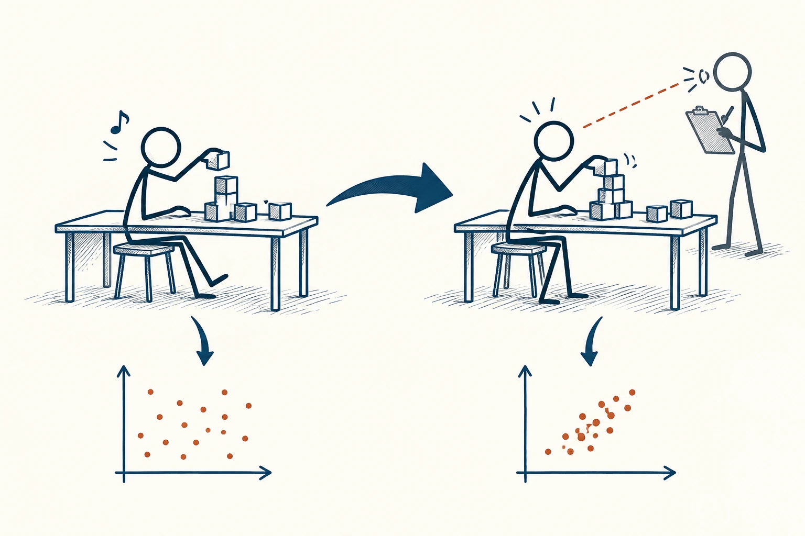

# 88 · 霍桑效应

Hawthorne Effect · 行为与成长

> 知道有人在看时，我们的表现可能会变；这不一定是新方法的功劳。

*配图说明：被观察时行为改变的两场景：同一火柴人做同一堆积木任务，左侧自然状态姿势随意，右侧注意到研究者眼睛与记录板后姿势更刻意谨慎，两侧结果点分布不同但不标谁更好。*

## 定义

老师站在旁边，你可能坐得更直；团队正在试点新制度，大家也可能格外认真。霍桑效应常被用来提醒：被观察、被研究或受到额外关注，本身就可能影响行为，所以试点时的表现，不一定等于平时会怎样。

霍桑效应通常用来指个体因意识到自己受到观察或研究而改变行为的现象，其影响方向与大小需要具体检验。

这个名称来自早期工作场所研究，但那些研究该如何解释，长期存在争论。日常不必背故事，只要记住一个检查问题：效果看起来变好了，是安排本身更好，还是大家暂时知道“有人在看”？也可能两种都有。

## 举个身边的例子

你试着在群里每天打卡学习，第一周格外积极，读书时间明显增加。你便觉得找到了永远有效的方法。几周后，群里不再热闹，自己的打卡也开始拖。

前一周的进步不一定是假的，它可能确实受到了关注和新鲜感支持。接下来要找的是，即使没那么多人看，也能坚持的安排，例如固定地点、适合的任务量和自测反馈。把短期推动变成长期习惯，需要补别的条件。

## 换个场景看看

你买了一个新记账本，前几天每天认真记录，之后慢慢忘记。可能本子确实好用，也可能新鲜感起了作用。继续几周，比拿头三天决定是否买给全家更稳妥。

## 可以这样试

**什么时候用得上：** 评估打卡、短期试点、公开监督和新制度时，很值得多问这一句。

1. 记录新方案之外，是否同时多了监督、提醒、赞扬或新鲜感。
2. 别只看第一周，等活动热度下降后再观察一段时间。
3. 如果依赖关注才有效，就把这种成本也算进去，而不是假装自然就能持续。

## 别用过头了

“有人看就更努力”不是人人都会发生，也可能变成紧张、迎合或回避。不能用霍桑效应解释所有改善，它只是需要排查的一种可能。

## 花一分钟试试

回顾一个新开始时特别有效、后来又松下来的安排。除了工具和方法，第一周还多了哪些关注或期待？

## 顺着看下去

- [24 · A/B 测试](025.md)
- [25 · 安慰剂效应](026.md)
- [86 · 正强化与负强化](060.md)

## 来源与延伸

- [Levitt & List · 原始照明实验再分析](https://research.monash.edu/en/publications/was-there-really-a-hawthorne-effect-at-the-hawthorne-plant-an-ana)

---

例子为方便理解而设置，不是真实案例报道。
