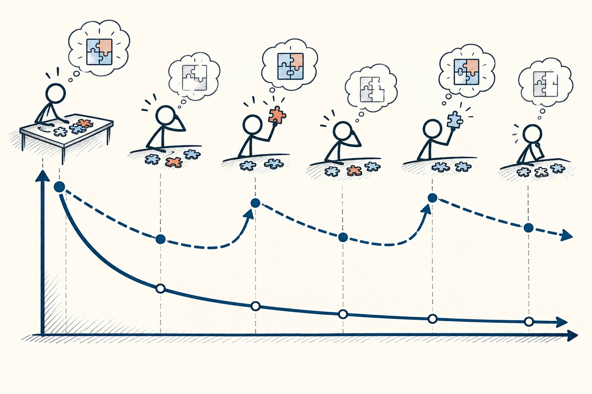
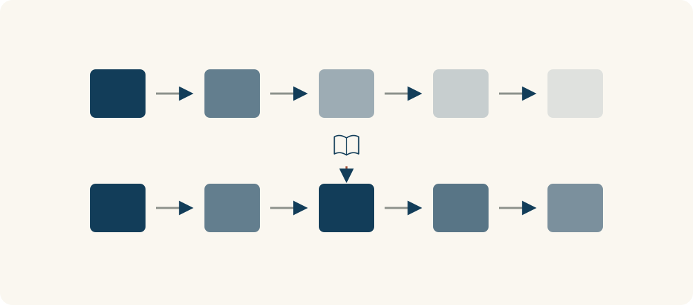

# 89 · 遗忘曲线

The Forgetting Curve · 行为与成长

> 刚看完觉得会了，不代表过几天还能自己说出来。

*配图说明：记忆随时间衰减与复习：一条藏蓝曲线先快速下降后趋平，旁边另一条在几次无数字时间点通过回忆练习小火柴人取出拼图片而抬升再下降。*

## 定义

你看一页笔记觉得全认识，合上书却想不起几个要点。这不奇怪，熟悉感和自己提取出来的能力，并不是同一回事。遗忘曲线提醒我们，记忆会随时间减弱；如果想长期用得上，需要在之后再次把它找出来。

遗忘曲线描述记忆保持随时间变化的过程，常表现为学习后较快下降、随后趋缓，但具体形状受到材料、学习和提取练习等因素影响。

最实用的办法，不只是反复看，而是间隔一段时间后主动回忆：不看材料讲一遍、做一道题、用在新例子里。费一点劲想起来，往往比顺着页面再读一遍，更能告诉你哪里真的会、哪里还虚。

读遗忘曲线时，先看它描述的是哪种材料、怎样学、怎样测。复习后的抬升也不是永远不会再掉；图上的趋势是帮助安排回忆练习，不是精确预测每个人哪天会忘掉多少。

*上排表示逐渐淡去的记忆；下排在中途加入回忆练习，随后保持情况可能不同。*

## 举个身边的例子

你为考试读了三遍讲义，感觉几乎都熟了，做题却总卡。可以改成每读完一小节就合上资料，写出几个核心点；第二天先试答问题，不会的再回看，过几天继续检查。

这样一开始可能觉得自己“怎么忘这么多”，实际上是更早暴露空白。你不再等到考场才发现只会认句子，却不会独立回答。复习的安排也能根据实际遗忘来调，而不是所有内容一律重读。

## 换个场景看看

刚学会做一道菜，过几天自己不看视频做一次，忘了哪一步再补哪一步，通常比每天刷同一个视频更能变成自己的手艺。

## 可以这样试

**什么时候用得上：** 背词、准备考试、读专业书，或你收藏很多却总想不起内容时，非常有用。

1. 学完后先关掉材料，用自己的话讲或写出主要内容。
2. 隔一段时间再试，记不住的多复习，已经掌握的把间隔拉长。
3. 给概念找一个自己的例子，让记忆和真实使用连起来。

## 别用过头了

别把网上某套固定天数和遗忘百分比当成人类统一说明书。材料难度、基础和练习都会影响记忆，适合自己的节奏要靠实际检查。

## 花一分钟试试

现在合上这一页，试着说出遗忘曲线最提醒你的一个问题，以及明天你准备怎样复习一个正在学的内容。

## 顺着看下去

- [85 · 复利效应](016.md)
- [87 · 内在动机](061.md)
- [94 · 优势思维](074.md)

## 来源与延伸

- [维基百科 · 遗忘曲线](https://en.wikipedia.org/wiki/Forgetting_curve)

---

例子为方便理解而设置，不是真实案例报道。
