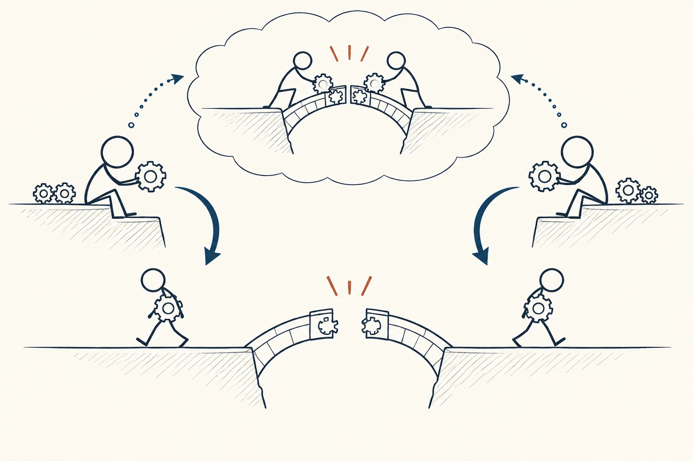
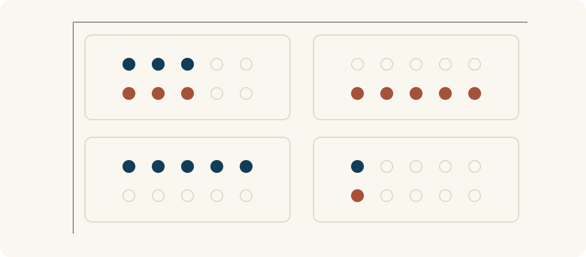

# 59 · 囚徒困境

Prisoner’s Dilemma · 伦理与协作

> 两个人都怕自己吃亏，最后却可能一起吃亏。

*配图说明：双向选择与共同损失：两个火柴人在分开的两侧各自决定把齿轮放入共享装置还是拿回自己一侧；上方淡淡的小场景呈现协作后桥梁连接，下方主场景呈现各自收回齿轮后桥梁断开、双方都被困住。无文字、非矩阵叙事结构。*

## 定义

两个人一起做事，明明互相配合对双方都更好，却都忍不住想：“如果他认真做，我少出点力也能占便宜；如果他不做，我更不能白忙。”结果两个人都选择不合作，事情反而做得更差。这就是囚徒困境想让我们看见的矛盾。

囚徒困境是博弈论中的经典模型：在标准的一次性两人博弈中，不合作是双方各自的占优策略，但双方不合作的收益都低于双方合作时的收益。

经典故事里，两名嫌疑人被分开询问。按题目设定，无论另一人怎么选，自己供认都能少受一些处罚；但两人都这么选，受到的处罚又比两人都保持沉默更重。这里讨论的是一个假设的选择结构，不是在介绍现实中的办案规则。

它最有用的提醒是：合作失败，有时并不只是某个人“人品不好”，也可能是规则让不合作看起来更划算。要改善结果，除了表达诚意，还要想办法让付出看得见、承诺能兑现，让双方不必靠猜测来保护自己。

读四格图时，可以让行表示你的选择，列表示对方的选择，各自按“合作、不合作”排列。每格同时看两个人的收益，再沿同一列比较自己的两种选择、沿同一行比较对方的两种选择；这样才能看清个人选择为什么会把双方带到更差的结果。

## 举个身边的例子

假设你和同学约好各整理一半复习资料，再相互分享。为了把关系看清楚，我们用一组假设的“净收益分数”表示资料带来的帮助减去整理的辛苦，分数越高越划算，并不是真实测量。双方都整理，各得3分；你不整理而对方整理，你得5分、对方得0分；反过来则你得0分、对方得5分；双方都不整理，各得1分。

站在你这边看：对方整理，你不整理能从3分变成5分；对方不整理，你不整理能从0分变成1分。同学也会做出同样的比较，于是两人都不整理，各得1分，反而不如合作时各得3分。困境就在这里：每个人单独看都更划算的选择，合在一起却没有让双方过得更好。

现实中可以调整合作方式：先各交一小部分，确认质量后再继续；明确每个人的任务和完成时间，让贡献能够核对。这样是在改变合作条件，而不只是要求对方“相信我”。

*行和列都按合作、不合作排列。每格上排藏蓝点表示你的净收益，下排砖红点表示对方的净收益；四格依次为3与3、0与5、5与0、1与1，仅为假设示例。*

## 换个场景看看

两个相邻团队都需要维护一份共享文档。维护要花时间，直接看别人更新却很省事；如果双方都想搭便车，文档就越来越旧，最后谁都不好用。这个场景是否构成严格的囚徒困境，还要看双方对时间和资料价值的真实比较，但它提醒我们检查“谁承担成本、谁得到好处”。

可以先试轮值更新、明确维护范围、记录贡献，并让双方及时反馈缺漏。关键是让合作的付出与回报更容易对上，而不是反复指责对方不主动。

## 可以这样试

**什么时候用得上：** 两人或两个团队都有合作空间，却因为怕搭便车、怕先付出吃亏而互相防备时，可以用它检查背后的规则。

1. 分别写出双方的两个选择，再列出四种组合，看看每种结果对谁有利。
2. 检查不合作为什么更诱人：是不是能搭便车、承诺无法核对，或合作后怕得不到回报。
3. 先做一轮可核对的小合作，明确交付、反馈和退出方式，再决定是否继续。

## 别用过头了

不是所有合作不顺都叫囚徒困境。经典的一次性模型要求：无论对方怎么选，不合作对自己都更划算，但双方不合作又都不如双方合作。生活中的收益、关系和动机未必符合这个设定；反复合作、公开信息或调整规则可能改变结果，也不保证一定成功。理解困境不等于一味让步，保护边界和及时退出同样重要。

## 花一分钟试试

找一件你和别人都在等对方先做的事。画四格，填上“双方都做、只有我做、只有对方做、双方都不做”的结果。再写一个能降低先付出风险的小安排。

## 顺着看下去

- [58 · 双赢思维](057.md)
- [57 · 可信度四核心](042.md)
- [77 · 反馈回路](066.md)

## 来源与延伸

- [OpenStax · 囚徒困境与收益矩阵](https://openstax.org/books/principles-economics-2e/pages/10-2-oligopoly)

---

例子为方便理解而设置，不是真实案例报道。
