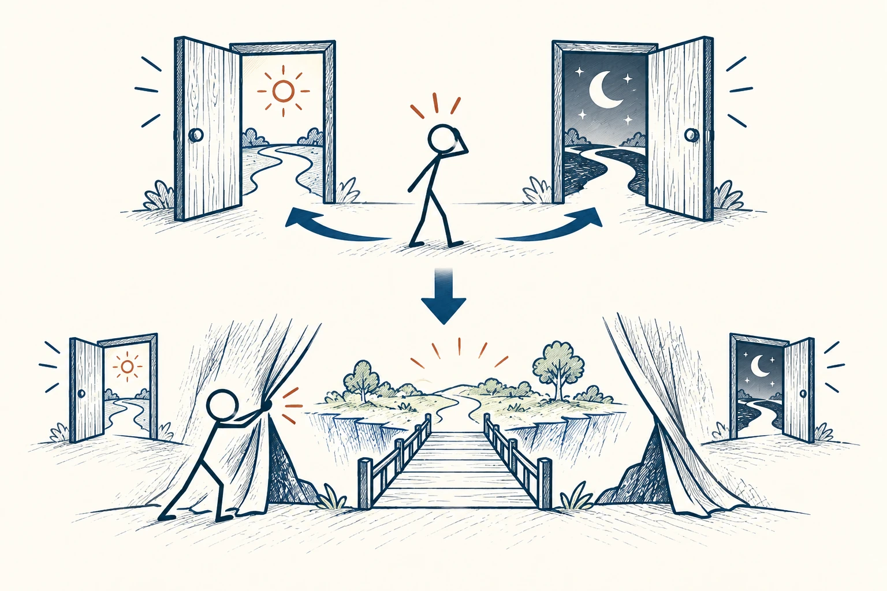

# 15 · 虚假两难

False Dichotomy · 认知与推理

> 听到“不是这样，就是那样”，先看看有没有被藏起来的第三条路。

*配图说明：虚假两难到发现第三条路：上方两扇大门夹住困惑火柴人，看起来只有两选；下方观察者拉开侧边幕布露出第三条可行桥路，原来的二分边框被打开。*

## 定义

“要么立刻辞职，要么忍一辈子”“不马上买，就永远买不到”“不赞同我，就是站到别人那边”——这些话把选择压成了两端，却可能遗漏等待、调整、分阶段或组合方案。这就是虚假两难。

虚假两难是一种论证错误，将并未穷尽可能性的选项描述为仅有的两个选择，从而掩盖其他可行路径。

它和真正的二选一不同。有些截止时间确实只能报或不报，但在决定之前，往往还能查条件、找替代、谈时间。多找一条路，不是为了永远不决定，而是避免在别人画好的两个极端里被迫选。

## 举个身边的例子

你想学画画，但觉得“要么辞职读专业学校，要么永远别想认真学”。其实还可能先报短课、每周固定练习、请老师看作品，或用半年确认自己喜欢的方向与现实条件。

这些办法未必能替代所有专业训练，却能让你在承担重大代价前多了解自己。你可能更确定要转行，也可能发现当作长期爱好更合适。第三条路的作用，是让决定有更多信息，不是保证最终两边都要到。

## 换个场景看看

想参加聚会又担心太晚，可以只去前半场；预算不够买新设备，可以先租或借；无法承担整项任务，也可以说明能负责哪一段。调整范围常能带出新选择。

## 可以这样试

**什么时候用得上：** 压力很大的说服、重大选择，或你觉得只有两个都不想要的选项时，尤其值得用。

1. 把被摆到面前的两个选项写出来，检查它们是否真的覆盖所有可能。
2. 尝试从时间、范围、顺序和参与方式上各想一个变化。
3. 回到真实约束，筛掉不可行的方案，再认真作决定。

## 别用过头了

并非所有冲突都有第三条路。有些规则和底线确实明确。想出新选项后，也要查代价，不能只靠“应该还有办法”无限拖延。

## 花一分钟试试

挑一个你正用“要么……要么……”描述的困难，写出至少一个分阶段方案，再看看它是否真的可行。

## 顺着看下去

- [06 · 非黑即白思维](008.md)
- [37 · 选择悖论](054.md)
- [38 · 权衡取舍](055.md)

## 来源与延伸

- [维基百科 · 虚假两难](https://en.wikipedia.org/wiki/False_dilemma)

---

例子为方便理解而设置，不是真实案例报道。
