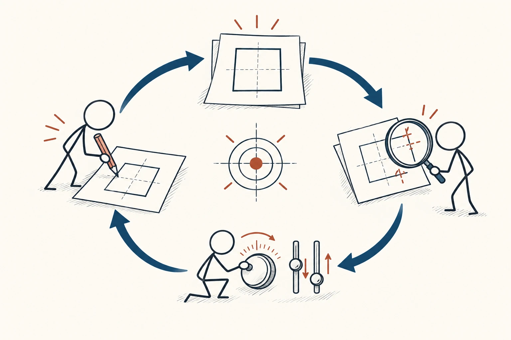
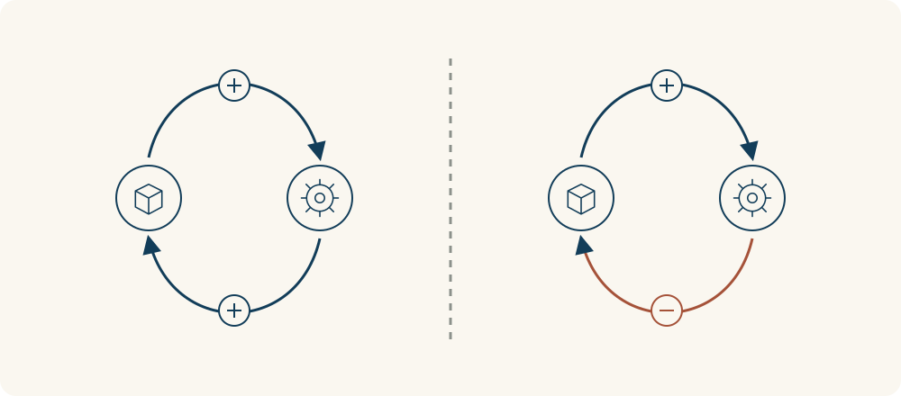

# 77 · 反馈回路

Feedback Loop · 系统与规律

> 有些结果会反过来推动原因，于是事情越滚越大，或慢慢稳下来。

*配图说明：绘制、观察偏差、调整，再回到下一轮绘制的闭合回路。*

## 定义

你越晚睡，白天越困；白天靠拖延熬到晚上，任务又越积越多，晚上更不敢睡。事情不是一条直线，而是绕成了圈。反馈回路就是这种“结果回来影响下一轮”的过程。看清这个圈，比只责备某一个环节更容易找到改变入口。

反馈回路指系统输出通过一系列因果联系返回并影响输入的过程，增强回路放大变化，平衡回路则趋向抵消偏离。

有些圈会放大变化，比如练习进步后更愿意练；有些会把偏离拉回来，比如空调达到温度就减少制冷。常说的正反馈、负反馈，指放大还是抵消变化，不是简单的好与坏。一个让问题越滚越大的圈，也属于增强变化。

普通流程只说明事情先后发生，反馈回路还要多画一条返回的线：这次结果怎样改变下一次行动？返回后可能把变化越推越大，也可能纠正偏差。循环本身不自动代表进步。

*左边两个环节互相增强变化；右边的返回作用会抵消偏离。正负反馈不等于好坏。*

## 举个身边的例子

你因为不懂一项工作而不敢提问，越不问就越慢，越慢越怕别人发现，接着更不敢问。只告诉自己“别焦虑”，未必能打断这条链。

可以先改变一个小环节：固定每天集中问两个具体问题，或请人一起做第一遍。理解多一点，完成就快一点；进度改善后，提问也不再那么可怕。你不需要等所有问题都消失，先找到能够启动正向变化的入口。

## 换个场景看看

客服回复慢，用户重复催问，工单更多，回复更慢。增加明确的处理进度、减少重复提交，可能比单纯催客服更能打断循环。

## 可以这样试

**什么时候用得上：** 习惯反复、工作积压、关系越吵越僵，或某种进步开始越做越顺时，很适合用。

1. 把问题画成三四个相连的箭头，看看最后会不会绕回开始。
2. 找一个能控制、改动小的环节，不一定从最显眼的后果开始。
3. 给变化一点时间，再观察整个圈是否开始减弱或换方向。

## 别用过头了

画出的箭头只是你的理解，还需要事实验证。变化可能有延迟，过早加大干预，反而容易来回折腾；也别把系统外的新影响漏掉。

## 花一分钟试试

把一个反复出现的烦恼画成一个圈，每个箭头旁写“怎么影响下一步”。圈出一个这周能做小改动的位置。

## 顺着看下去

- [73 · 熵与热力学第二定律](017.md)
- [75 · 临界规模与引爆点](053.md)
- [76 · 墨菲定律](059.md)

## 来源与延伸

- [维基百科 · 反馈回路](https://en.wikipedia.org/wiki/Feedback)

---

例子为方便理解而设置，不是真实案例报道。
