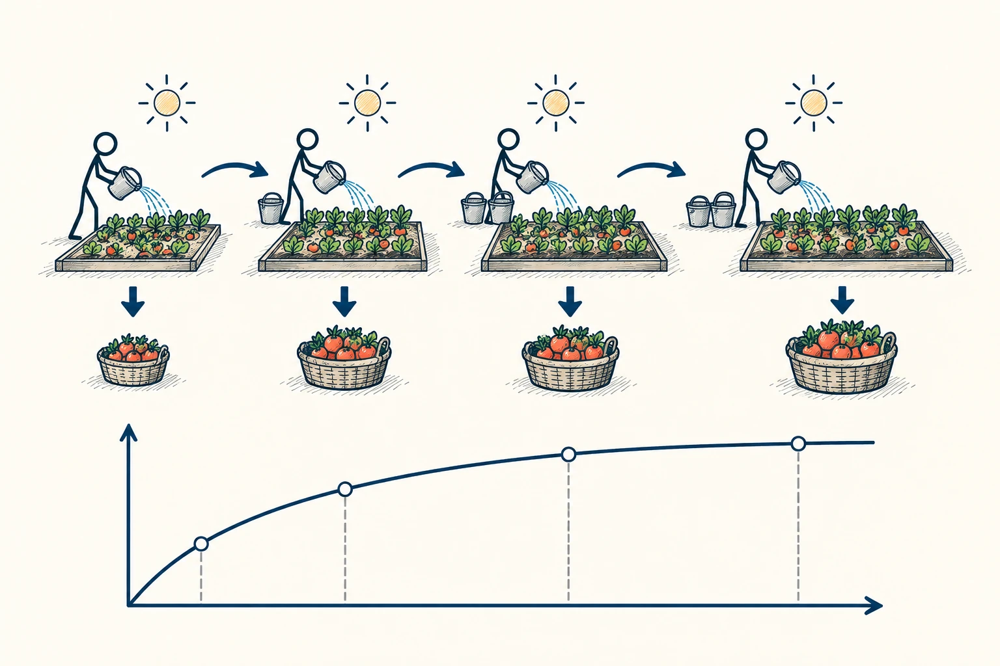
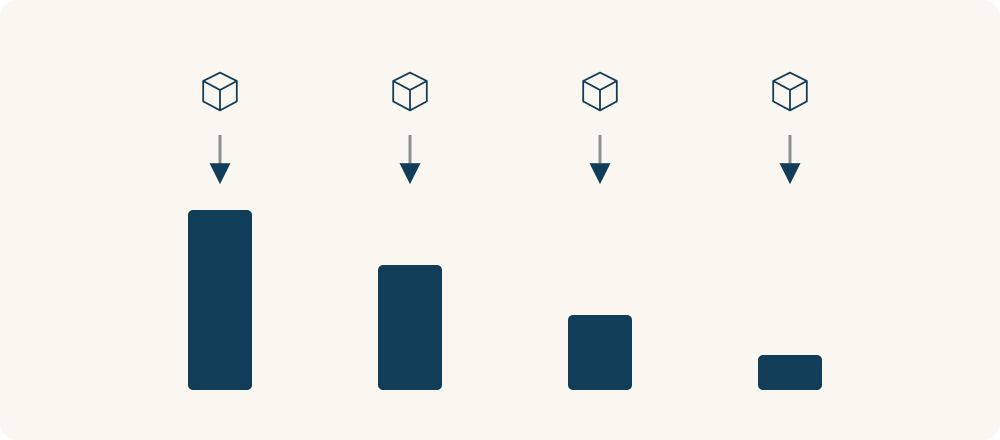

# 78 · 收益递减规律

Law of Diminishing Returns · 系统与规律

> 同一件事继续加力，后面每多一点投入，可能换回的越来越少。

*配图说明：固定条件下新增产出趋减：一块固定大小菜地与同一太阳不变，火柴人连续增加同样大小的水桶投入，每次新增收获篮依次变小，但总收获仍增。*

## 定义

收拾房间，前二十分钟把杂物归位，变化很明显；之后一小时反复调整几个小摆件，改善却不多。收益递减提醒我们看“再多做一点”的价值，而不只看“已经做了多少”。事情未必变坏，只是后面每一份力带来的额外好处变少了。

边际报酬递减指在技术和部分投入要素固定等条件下，持续增加某一投入，其带来的新增产出最终会趋于减少。

这个概念在经济学里有具体条件，例如其他资源暂时不变。借到日常，先问一句就很有用：现在真正卡住结果的还是努力不够，还是时间、空间、方法或反馈已经成了限制？找错限制，只会越加越累。

这里最好把“总共得到多少”和“这一份新增投入多带来多少”分开。总收获仍可能增加，但每多加一桶水带来的额外收获在变小。递减说的是新增部分，不是总量一定开始下降。

*上方每份新增投入相同，下方对应的新增收获逐次减小；这不等于总收获下降。*

## 举个身边的例子

你准备一份十分钟的分享，最初两小时把结构与例子讲清楚，质量提升很大。随后三小时一直换字体、调一句话，讲给听众时却发现，他们根本没听懂中间一个概念。

继续润色外观的额外价值已经很小，换成找一位新手试听十分钟，可能更有帮助。不是细节永远不重要，而是此刻最有价值的投入位置变了，你需要跟着换，而不是因已经花很多时间就继续原地加码。

## 换个场景看看

厨房只有一口锅，两个人做饭可能更快，五个人同时挤在灶台前却容易互相挡路。问题不一定是谁不努力，而是固定空间已经限制了额外人手的作用。

## 可以这样试

**什么时候用得上：** 反复修改、越学越疲惫、不断加人却没有更快，或你不知道该不该继续投入时，很值得用。

1. 每投入一段时间，问问刚才具体改善了什么。
2. 找出当前最限制结果的环节，看看是否需要换方法或补资源。
3. 比较继续做这一小步，与休息、请人反馈或开始别的事，哪个更值得。

## 别用过头了

收益变少不等于总收益为负，也不是“努力没用”。有些长期能力需要持续积累，短期不明显；判断时要结合目标和时间范围。

## 花一分钟试试

找一件已经做了很久的任务，写下接下来半小时最可能带来的改善。如果说不清，是否该换一种投入？

## 顺着看下去

- [65 · 最小有效剂量](044.md)
- [36 · 成本效益分析](051.md)
- [69 · 二八法则与帕累托原则](056.md)

## 来源与延伸

- [维基百科 · 收益递减规律](https://en.wikipedia.org/wiki/Diminishing_returns)

---

例子为方便理解而设置，不是真实案例报道。
