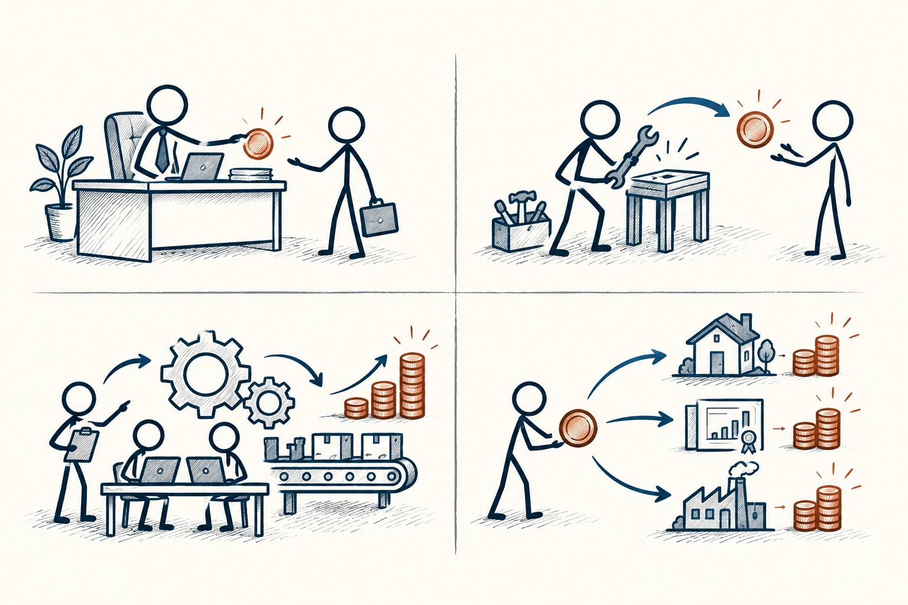

# 90 · 现金流象限

Cashflow Quadrant · 行为与成长

> 看看钱从哪里来、需要你做什么，比只盯着职业名称更清楚。

*配图说明：四象限收入角色：四格分别画火柴人在企业岗位领取一份硬币、独自用工具提供服务得收入、协作团队与流程机器持续运行、投入资源到不同资产获得回流。*

## 定义

现金流象限把收入角色粗分为四种：领取薪酬的雇员、主要靠自己接活的自雇者、组织企业运转的所有者，以及投入资产的投资者。你可以把它当成几副观察收入的眼镜，而不是人生必须一级级升级的楼梯。

罗伯特·清崎的现金流象限按收入角色区分雇员、自雇者、企业所有者与投资者，它是个人财务观察框架，而非完整的职业或财富分类。

一个人也可能同时处在几个位置。重要的是每项收入需要多少时间、承担什么风险、有没有稳定性，以及你离开几天后会发生什么。这个框架能提出问题，但不会保证某个象限一定更自由、更赚钱。

四个象限用来并列观察收入来源与承担的角色，不是四个必须逐级爬升的层次。同一个人也可能同时有工资收入和投资收入，跨格并不自动意味着风险更低或生活更好。

*四格是不同收入角色，同一个人可以同时处在不止一格。*

## 举个身边的例子

你在公司做设计，同时周末接个人项目。工资属于雇员角色，接单又带着自雇特点。后来你找伙伴分工，工作开始依赖团队和流程，但也增加了获客、管理与交付责任。

如果还持有投资资产，又多了一种收入和风险来源。标签变了，并不等于生活自动更轻松。与其羡慕一个看起来高级的象限，不如把真实投入和压力写出来，看看哪种安排适合自己的能力、家庭和阶段。

## 换个场景看看

一位开小店的人，名义上是老板，却每天都得亲自开门关门。有没有团队、流程和替代安排，往往比称呼更能说明他是否拥有时间自由。

## 可以这样试

**什么时候用得上：** 你在考虑副业、接单、创业或调整工作方式时，可以用它帮助梳理，而不是急着换身份。

1. 把收入按来源列出来，不只写一个职业头衔。
2. 每项补上花多少时间、需要哪些能力、可能失去什么、能否稳定持续。
3. 考虑变化时，先试着了解日常工作与责任，不只听成功故事。

## 别用过头了

“被动收入”也可能需要前期大量劳动、持续维护或承担损失。不能把雇员说成低级，也不能把创业和投资当作人人适合的保证路线。

## 花一分钟试试

选一项你羡慕的收入方式，除了“能赚多少”，再写三个想问从业者的问题：每天做什么、最难什么、收入差时怎样应对？

## 顺着看下去

- [36 · 成本效益分析](051.md)
- [38 · 权衡取舍](055.md)
- [94 · 优势思维](074.md)

## 来源与延伸

- [Rich Dad · 现金流象限与四种收入方式](https://richdad.com/cashflow-quadrant-fundamentals/)

---

例子为方便理解而设置，不是真实案例报道。
