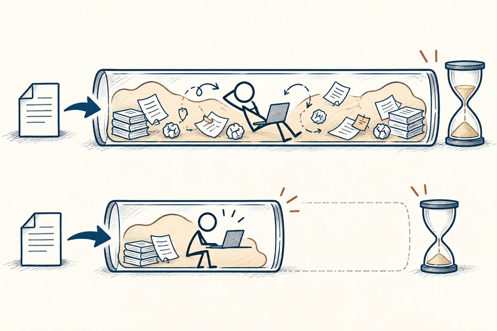
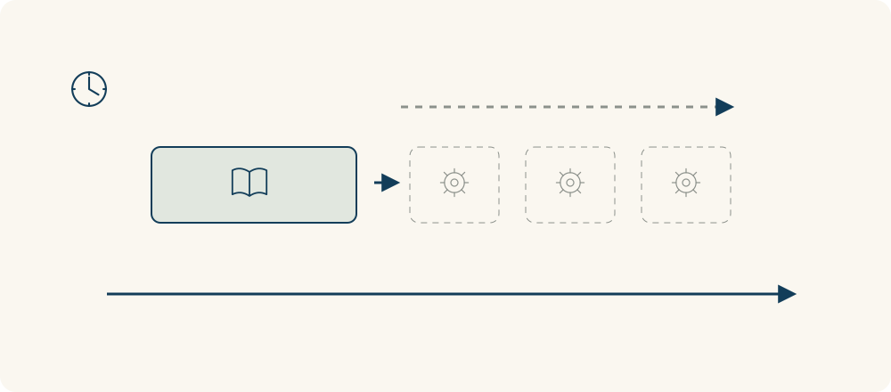

# 70 · 帕金森定律

Parkinson’s Law · 工具与行动

> 时间给得很松，任务有时就会跟着长胖。

*配图说明：任务膨胀占满时间容器：两个透明横向时段框一长一短，内部相同任务的橡皮状轮廓分别扩展到填满各自框，火柴人在长框内拖延调整细节，在合理短框内聚焦完成。*

## 定义

一封普通邮件原本十分钟能写完，因为你给自己留了整个下午，便不停改开头、查措辞、等更好的状态。帕金森定律把这种现象概括为：工作会膨胀，填满给它的时间。它是一种观察性提醒，不是能推算所有工时的自然定律。

帕金森定律是西里尔·诺思科特·帕金森提出的组织观察，其核心意思是工作可能扩展以占满为其安排的时间。

有用的做法，是给任务一个合理时间盒，并先说清什么算完成。你不是拿闹钟逼自己飞速工作，而是减少没必要的扩张。到点后可以根据质量和剩余风险决定是否续时，不用把“还可以再改”当成永远不交付的理由。

把同一个任务放进长短不同的时间容器，容易看出哪些工作是必要的，哪些只是随时限膨胀出来的细节。但容器也不能小到装不下必要工作，合理截止时间仍要尊重任务本身。

## 举个身边的例子

你要给同事写一份内部说明，目标只是让大家知道问题、方案和需要决定的事。原本打算“今天弄完”，结果上午选模板、下午调排版，核心意思还没写清。

换成先给四十分钟写一页可讨论的草稿，遇到不确定处直接标注，再用十分钟检查。你可能更早拿到反馈，知道真正需要补哪里，而不是独自把不重要的部分打磨一整天。

*实心部分是必要工作，虚线部分表示随时限增加而扩展的细节。*

## 换个场景看看

整理一整天邮箱可能永远做不完；限定二十分钟处理需要回复的邮件，并把归档留到另一个时间段，反而能让真正重要的动作发生。

## 可以这样试

**什么时候用得上：** 任务总拖到最后、为小细节反复磨，或你只有“今天要做”却没开始边界时，很适合用。

1. 开工前写清完成标准，例如“一页纸讲清三个问题，供明天讨论”。
2. 给第一版设一个现实的时间盒，把复杂任务拆成几段。
3. 到点检查还缺什么，只为必要部分追加时间，别无期限地微调。

## 别用过头了

不是期限越短越好。创作、研究和有外部依赖的任务确实需要时间与缓冲，不能用这条说法逼人接受不现实的工期。

## 花一分钟试试

给一个小任务设定“完成到什么程度”与二十五分钟的时间盒。结束时记录实际缺口，再决定是否继续，不默认无限延期。

## 顺着看下去

- [65 · 最小有效剂量](044.md)
- [69 · 二八法则与帕累托原则](056.md)
- [78 · 收益递减规律](067.md)

## 来源与延伸

- [维基百科 · 帕金森定律](https://en.wikipedia.org/wiki/Parkinson%27s_law)

---

例子为方便理解而设置，不是真实案例报道。
