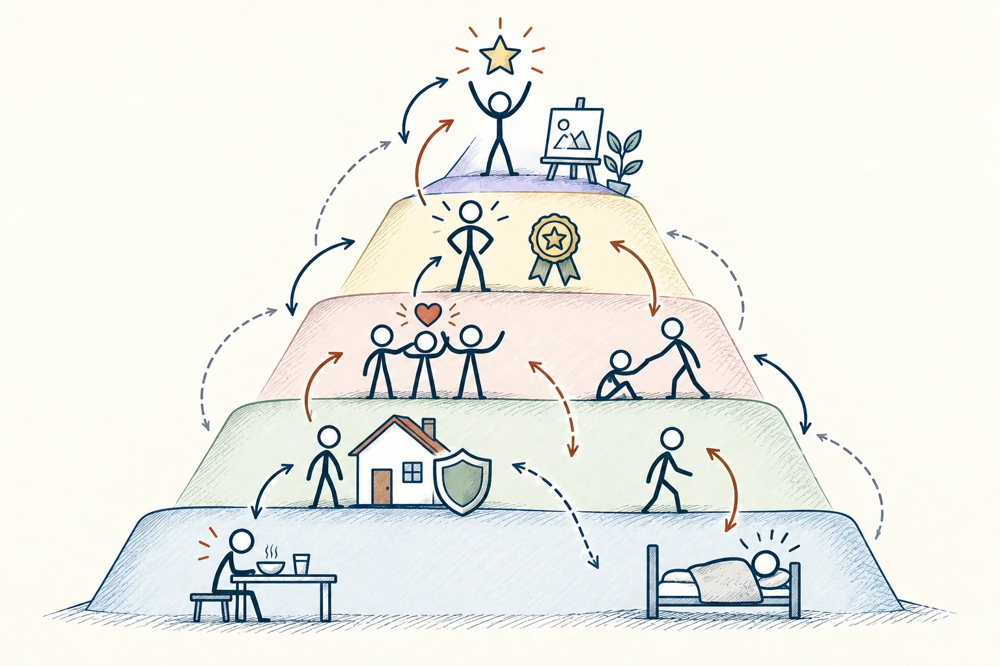
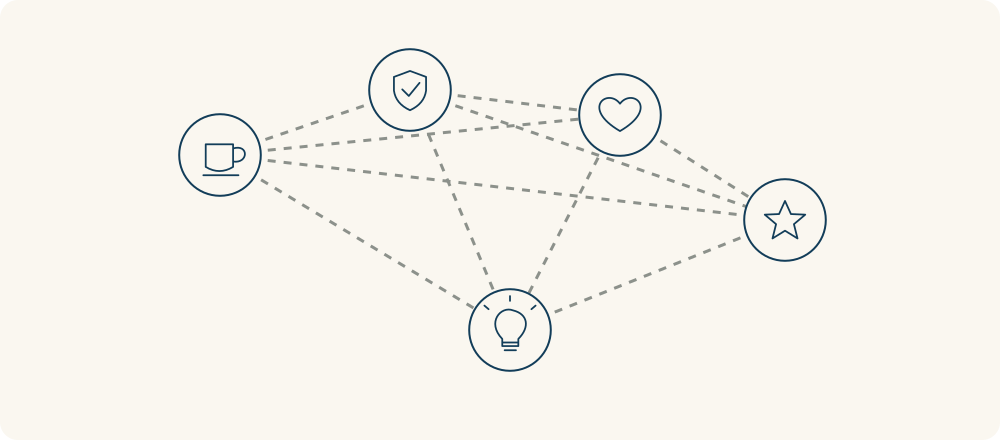

# 91 · 马斯洛需求层次理论

Maslow’s Hierarchy of Needs · 行为与成长

> 人的需要不只有钱和成绩，也有安全感、关系、尊重和成长。

*配图说明：五层需求但允许交叠：五层半透明阶梯或山体，依次用食物水、房屋盾、朋友牵手、认可奖章、创作星星图标，火柴人可通过旁边多条灵活连线在层间移动，边界虚线不作绝对门禁。*

## 定义

马斯洛需求层次常被画成金字塔，从吃饭睡觉等基本需要，到安全、归属、尊重，再到发挥潜力。把名字放一边，它最有用的提醒是：想理解一个人为什么没劲、为什么在意某件事，不能只盯一个目标。

马斯洛需求层次理论以生理、安全、归属与爱、尊重及自我实现等需要解释人的动机，但这些需要并非总按严格、互不重叠的顺序出现。

一个人没有稳定休息时，空喊成长可能不够；觉得自己不被接纳时，多发一点奖品也未必解决孤独。同时，现实不是必须一层“通关”才能想下一层。条件不完美的人，也可能追求爱、创造和意义，多种需要常一起存在。

层级图能帮助记住几类需要，却容易让人误会成严格通关：下层没完全满足，就不能出现上层需要。理解时可以保留交叠和跨层联系，人可能同时在意安全、关系与创造。

*几类需要可以同时产生联系，不必等某一层全部满足后，另一层才出现。*

## 举个身边的例子

你想靠制定更高目标让自己振作，却发现越写越烦。回看最近生活：经常睡不够、工作安排随时变动，又很久没和朋友认真说话。你缺的可能不只是一个宏大愿望，而是基础生活与连接都被挤压了。

先把睡眠安排稳一点、减少一项不必要任务、约一次能放松的聊天，再看学习和工作计划。你不是因此失去上进心，而是在给上进找一个能站稳的地方。

## 换个场景看看

新同事不愿发言，未必没有想法，也可能还不知道说错会不会被嘲笑。安全的讨论氛围和被认真回应，有时比再讲一次“大家积极一点”更有帮助。

## 可以这样试

**什么时候用得上：** 团队士气低、自己提不起劲，或你给了很多奖励却仍帮不上对方时，可以用它多看看。

1. 从几个方面检查：身体是否被照顾，安排是否稳定，是否有人支持，是否受到尊重，是否有成长空间。
2. 找出当下最明显的缺口，别只按自己最熟悉的方法补。
3. 先做一个具体调整，再听自己或对方的反馈，看看需要是否猜对。

## 别用过头了

这个框架适合作为提问清单，不是判断所有人的固定顺序。不要因为别人收入少，就认为他没有审美、理想和尊重的需要。

## 花一分钟试试

在休息、安全感、关系、尊重、成长旁各写一句最近的真实情况。选一个最缺的方面，安排一项小改善。

## 顺着看下去

- [92 · 盖洛普 Q12](072.md)
- [87 · 内在动机](061.md)
- [94 · 优势思维](074.md)

## 来源与延伸

- [维基百科 · 马斯洛需求层次理论](https://en.wikipedia.org/wiki/Maslow%27s_hierarchy_of_needs)

---

例子为方便理解而设置，不是真实案例报道。
