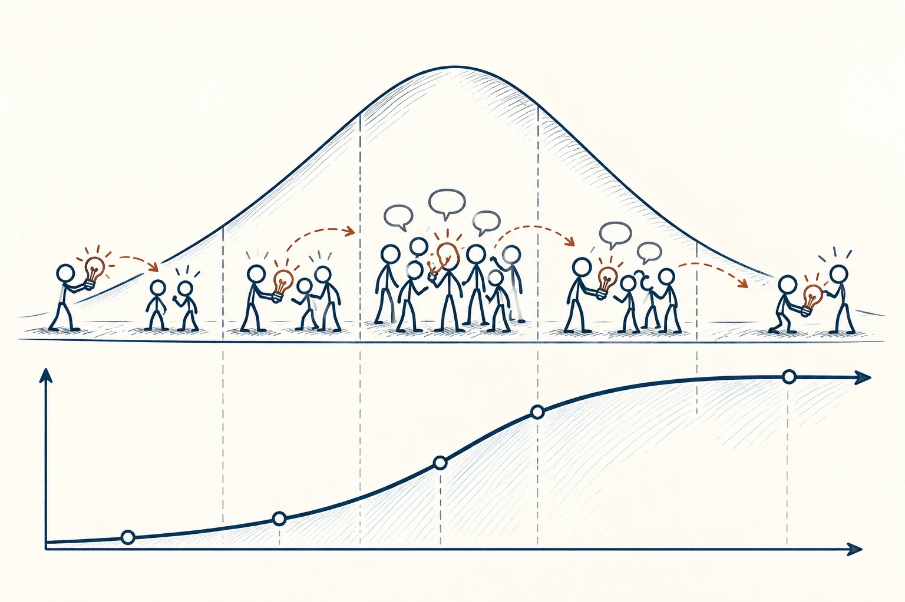
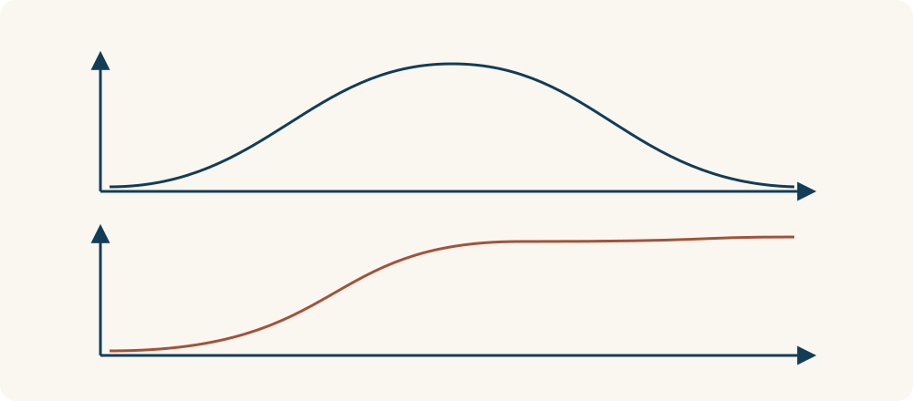

# 79 · 创新扩散曲线

Diffusion of Innovations Curve · 系统与规律

> 爱尝鲜的人先来，不代表其他人会因为同样的理由跟着来。

*配图说明：创新扩散的采用时间结构：左到右一条平滑钟形分布带，前端少量火柴人尝试新工具，中央多数人跟进，后端少数人较晚加入，群体通过沟通线传播。*

## 定义

一件新东西出现，有人马上想试，有人等朋友用过，有人要等旧东西坏了才换。创新扩散曲线把采用时点不同的人概括成几组，帮助我们看到：不同阶段的人，顾虑和期待往往不同。

罗杰斯的创新扩散理论按相对采用时间，将采用者概括为创新者、早期采用者、早期多数、晚期多数与滞后者，用于理解创新在社会系统中的传播。

常见图上写着2.5%、13.5%等比例，可以先把它们当作模型里的分段，不必当成每个行业必然符合的数字。对日常使用更重要的是，愿意忍受麻烦的早期用户，和需要稳定省心的后续用户，不能用同一套说明对待。

这类图常见两种曲线：一条看每个阶段新加入多少人，可能先少、后多、再少；另一条看累计已有多少人采用，通常只会继续累加。两条曲线回答不同问题，不能把下降的新增人数读成累计用户都离开了。

*上图看每阶段新加入的人，下图看截至当时累计加入的人。*

## 举个身边的例子

你向家人推荐一个新记账工具，自己很喜欢它能自动分类、生成图表。爸妈却关心账号会不会丢、出了问题找谁、以前的记录怎么保留。你反复介绍新功能，他们仍不想换。

先陪他们解决迁移、找回和基本操作，可能比继续展示高级图表更有效。晚一点接受，并不代表固执，而是承担的成本、需要的信息和你不一样。推广的任务，是降低真实困难，不是责怪别人不够先进。

## 换个场景看看

社区开始线上预约设施，熟悉手机的人很快适应，但其他人可能需要线下帮助和简单入口。给出过渡方式，比把问题归为“不愿学习”更能扩大实际使用。

## 可以这样试

**什么时候用得上：** 推广工具、组织新活动、引入工作流程，或早期评价好却迟迟无法普及时，很值得用。

1. 先了解现在愿意尝试的人，到底为了什么来、愿意忍受什么。
2. 再问下一批人最担心哪件事，别只找已经喜欢的人聊天。
3. 补稳定性、例子、迁移和支持，让采用变得合理，而不是只增加宣传。

## 别用过头了

同一个人可能对手机爱尝鲜，对理财工具很谨慎。类别不是永久性格，晚采用也可能是符合需要的好决定。

## 花一分钟试试

选一个你很想推荐的工具，写下除了“功能好”之外，别人可能担心的三件事。哪一件你已经有办法帮助解决？

## 顺着看下去

- [12 · 可得性启发式](027.md)
- [46 · 影响力六原则](033.md)
- [75 · 临界规模与引爆点](053.md)

## 来源与延伸

- [维基百科 · 创新扩散曲线](https://en.wikipedia.org/wiki/Diffusion_of_innovations)

---

例子为方便理解而设置，不是真实案例报道。
