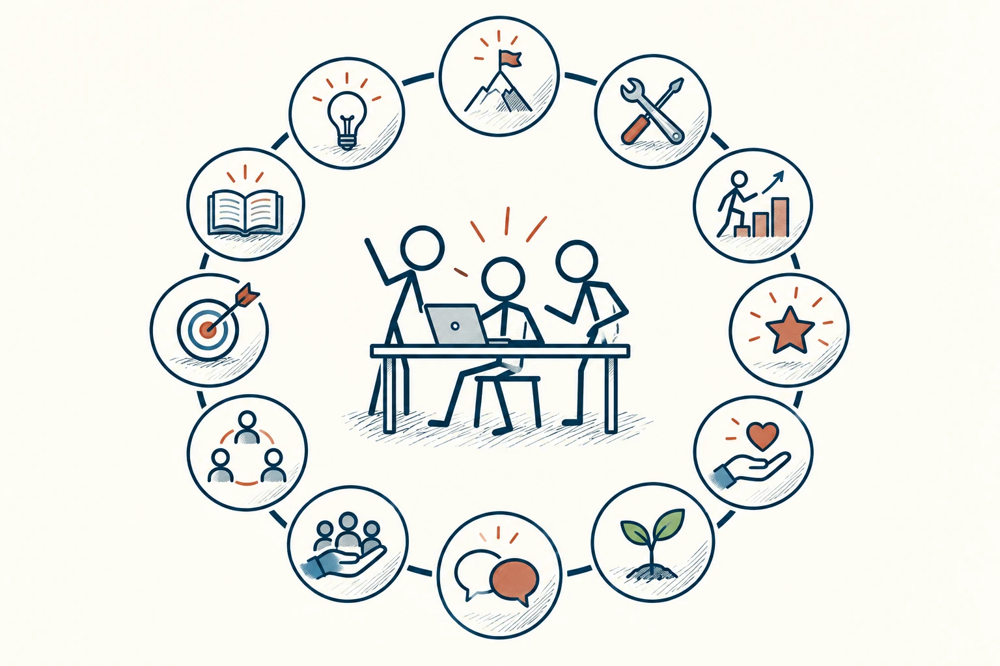

# 92 · 盖洛普 Q12

Gallup Q12 · 行为与成长

> 想知道一个团队为什么没劲，别只问“大家满不满意”。

*配图说明：工作投入条件的十二节点环：围绕一个在团队中工作的火柴人，十二个独立小图标分别表示清楚方向、工具资源、发挥能力、认可、关心、成长、倾听、意义、同事质量、伙伴、反馈和学习；只画通用图标，不复刻盖洛普问卷原题，不放数字。*

## 定义

盖洛普Q12是一套员工敬业度工具。入门可以先理解它关注的方向：知道自己该做什么吗，有没有合适资源，贡献是否被看见，有没有支持、连接与成长？这些问题比一句“你怎么不积极”更接近真实工作体验。

根据盖洛普对Q12的介绍，这是一套由十二个题项组成的员工敬业度测量工具，关注与工作表现相关的工作场所条件。

本页介绍这种观察角度，不照搬完整的专有问卷，也不提供官方评分。对普通读者来说，最有用的是把模糊的士气问题，拆成可以谈、可以改的小事，而不是测出一个数字就结束。

## 举个身边的例子

一个小团队最近交付变慢，负责人准备安排团建，让大家“恢复热情”。但聊天后发现，大家每天收到不同优先级，做完任务又被说不是最重要的；提出问题也得不到明确回应。

此时更有效的改善，可能是每周确定重点、说明谁来拍板，并对反馈给出后续。聚会可以让人放松，却不能单独解决目标混乱。真正让人重新投入的，常是日常工作终于变得能理解、能推进。

## 换个场景看看

你也能借这些问题看自己的工作：不是问“我够不够努力”，而是问“我知道重点吗，有工具吗，有人给反馈吗”。有些困难需要争取支持，不能全靠自责扛。

## 可以这样试

**什么时候用得上：** 团队士气低、流动频繁，或你想知道管理安排是否真的帮助了成员时，可以从这些方向开始。

1. 围绕目标、工具、认可、支持和成长，问近期发生过什么具体事情。
2. 让大家知道反馈怎样被使用，减少担心说真话会吃亏的压力。
3. 挑一两项能改的事情去做，之后告诉大家改了什么、还有什么没解决。

## 别用过头了

不要为了好看而逼大家打高分，也别根据分数给个人贴“不敬业”的标签。正式使用Q12时，需要按盖洛普的相应授权和方法进行。

## 花一分钟试试

挑一个工作中最常让你卡住的点，写一个具体例子，以及你希望获得哪种支持。把“环境不好”变成可讨论的请求。

## 顺着看下去

- [57 · 可信度四核心](042.md)
- [87 · 内在动机](061.md)
- [94 · 优势思维](074.md)

## 来源与延伸

- [Gallup · Q12 Employee Engagement Survey](https://www.gallup.com/q12-employee-engagement-survey/)

---

例子为方便理解而设置，不是真实案例报道。
