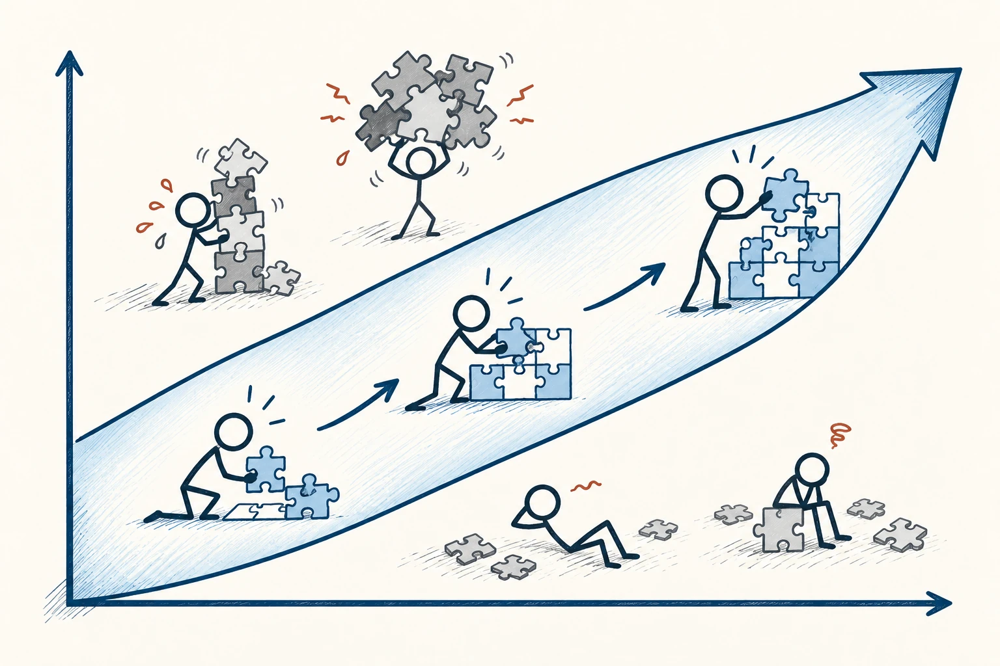
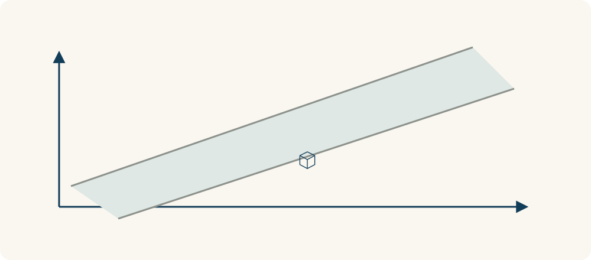

# 93 · 心流

Flow · 行为与成长

> 难度刚好够你伸手去够，又知道下一步做什么时，人更容易投入进去。

*配图说明：技能与挑战匹配的斜向通道：无字双轴平面中一条从左下到右上的宽藏蓝通道，通道内火柴人专注拼图；通道上方挑战过高的人紧张，通道下方挑战过低的人无聊，通道随技能挑战共同提高延伸。*

## 定义

你可能有过这样的下午：写东西、做手工或打球时很专心，回过神才发现时间过得很快。心流指这种深度投入的状态。它常与清楚的目标、及时反馈，以及挑战和能力比较匹配有关。

契克森米哈赖提出的心流概念，描述人在活动中高度专注、投入且行动体验顺畅的心理状态，常与清晰目标、及时反馈及挑战与技能的匹配有关。

任务太简单容易无聊，太难又容易挫败。但匹配不是永远不费劲，而是费劲后仍看得到进展。你不必追求每件事都进入心流，可以先把环境和任务调得更容易专注，让投入更有机会发生。

挑战与技能需要放在一起看。技能提高后，原先有吸引力的任务可能变得无聊；挑战抬得太高，又可能让人紧张。心流更像随条件移动的一段匹配范围，不是一条永远适用的精确分界线。

*挑战与技能匹配时，更容易进入投入状态；匹配范围也会随成长改变。*

## 举个身边的例子

你刚学吉他，就照着高手的视频练整首复杂曲子，半小时后只剩沮丧。换成一个略有挑战的小节，放慢速度，能清楚听出哪一拍没对，再一点点连接起来，感受可能完全不同。

目标变小，反馈变快，难度也变得能接近。你可能开始愿意多练几轮，而不是每次都被整首曲子的差距压住。心流无法按按钮召唤，但合适的练习设计能减少不必要的卡顿。

## 换个场景看看

做拼图时，一眼能看出颜色和形状的细小差别，也能立刻看到是否拼对，容易让人持续投入。模糊、没有反馈的任务，往往更需要自己补上类似的小目标。

## 可以这样试

**什么时候用得上：** 学习、练技能、写作或需要长时间专注的工作，可以用它改善任务安排。

1. 为这一段时间设一个明确小目标，别只说“我要好好学习”。
2. 调整难度，太难就拆小，太容易就加一个具体挑战。
3. 减少通知和来回切换，安排能看见进步的反馈，也保留休息。

## 别用过头了

忘了时间不一定就是有价值的心流，刷视频也可能让人停不下来。仍要看是否符合自己的目标、身体是否需要休息，而不只追逐投入感。

## 花一分钟试试

为接下来三十分钟选一个具体目标，写出怎样知道自己有进展，然后把最容易打断你的一个入口先关掉。

## 顺着看下去

- [87 · 内在动机](061.md)
- [89 · 遗忘曲线](063.md)
- [94 · 优势思维](074.md)

## 来源与延伸

- [维基百科 · 心流](https://en.wikipedia.org/wiki/Flow_(psychology))

---

例子为方便理解而设置，不是真实案例报道。
