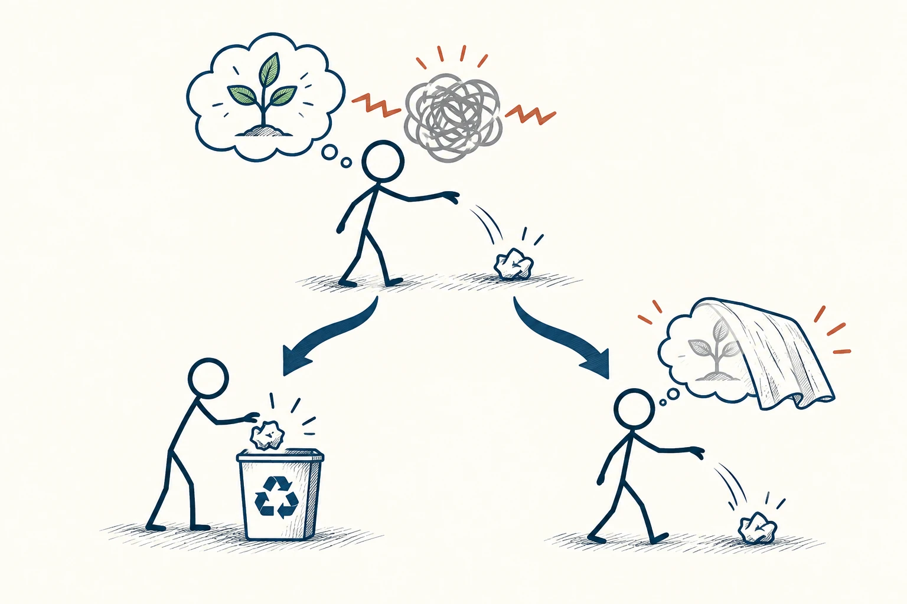

# 95 · 认知失调

Cognitive Dissonance · 行为与成长

> 当做法和自我认识对不上时，我们常会先替自己找个解释。

*配图说明：信念与行动不一致的张力：火柴人头中保护树木的小树图标，手却丢纸张到地面，中间两条不一致连线产生乱线；下方分两条回应，一条调整行为把纸放入回收箱，另一条只给原行为罩上薄薄遮挡表示辩解，后者用小砖红提醒。*

## 定义

你觉得自己很节俭，却冲动买了用不到的东西，于是说“这个以后一定会用上”；你认定自己讲道理，吵架后却一直只挑对方的错。信念、行为和自我形象打架时，人会不舒服，这种状态叫认知失调。

费斯廷格的认知失调理论认为，当相关认知或行为彼此不一致时，人会产生不适，并受到驱动去减少这种不一致或改变对它的解释。

为了舒服一点，我们可能改变做法，也可能调整想法，还可能寻找借口把冲突盖过去。知道这个过程，可以让你在急着辩解时停一下：我是在认真解释，还是主要想证明“我不可能判断错”？

## 举个身边的例子

你花不少钱报了一门课程，听了几次发现内容不适合，却因为怕承认看走眼，反复对朋友说“越听越有深度”。每次觉得难受，又继续花时间听，想证明当初决定值得。

你可以把两个问题分开：当时根据已有信息报名，可以理解；现在知道不合适，也可以调整。承认选择不适合，不代表你整个人愚蠢。自我评价松一点，才更容易把接下来的时间用到合适的地方。

## 换个场景看看

你重视准时，却连续迟到。与其一直强调“我其实是守时的人”，不如看出门流程哪里需要改。让行动慢慢靠近重视的东西，比保卫一个完美标签更省力。

## 可以这样试

**什么时候用得上：** 买后后悔、为错误决定辩护，或你发现自己说得越多却越不踏实时，很值得用。

1. 注意自己突然特别想证明“我没错”的时刻，先缓一缓。
2. 写出冲突在哪里，是行为和价值不一致，还是新证据与旧判断冲突。
3. 选一个真正能改善情况的动作，例如停止追加、承认失误或修改计划。

## 别用过头了

别人改口不一定是在找借口，也可能有了新信息。这个概念适合先检查自己，不要拿来隔空诊断所有不同意见。

## 花一分钟试试

为最近一次不太满意的选择写两句话：“当时我依据的是……”和“现在我多知道的是……”。接下来哪一小步可以根据新信息改变？

## 顺着看下去

- [31 · 损失厌恶](028.md)
- [14 · 确认偏误](035.md)
- [06 · 非黑即白思维](008.md)

## 来源与延伸

- [维基百科 · 认知失调](https://en.wikipedia.org/wiki/Cognitive_dissonance)

---

例子为方便理解而设置，不是真实案例报道。
