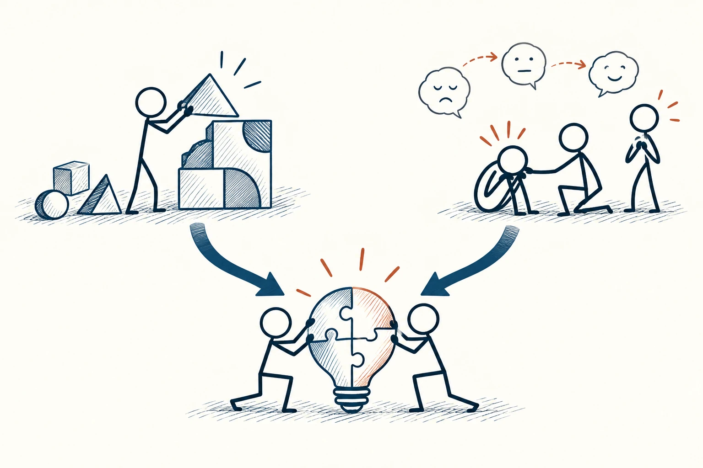

# 96 · 智商与情商

IQ vs. EQ · 行为与成长

> 想得清楚和处理好情绪，是不同能力，都可以具体练。

*配图说明：认知与情绪能力互补：左右两个区域，一个火柴人解几何拼图表示认知推理，另一位识别同伴表情并帮助调节表示情绪能力，两个区域向共同协作目标汇合。*

## 定义

大家常说“智商高、情商低”，但这句话很容易变成一个笼统标签。智商通常和标准化的认知能力测验有关，情商则有不同的理论和测法，常涉及识别、理解和调节情绪。它们不是两根互相抵消的柱子，也不能包办一个人的全部表现。

IQ通常指标准化认知能力测验所得的智力分数，情绪智力则涉及识别、理解及调节情绪等能力，其具体定义与测量随理论模型而异。

日常更有帮助的问法是：眼前究竟缺哪种具体能力？是信息没理清，还是一紧张就打断别人？是不会解题，还是不会表达自己需要帮助？问题越具体，练习才越有方向。

## 举个身边的例子

一位同事分析很快，但别人提出不同意见时，他立刻提高声音。大家说他“情商低”，他也觉得别人只想听好话，双方越想越远。

如果改谈具体行为，就有办法了：先让对方说完，复述争议点，发现自己语速加快时停一下，再针对证据回应。他不需要变得处处迎合，也不需要放弃专业判断，而是把“看见情绪并选择回应方式”这件事练得更好。

## 换个场景看看

你很能理解朋友的难过，却不知道怎样管理自己的焦虑，这并不矛盾。情绪识别、表达和调节也有不同侧面，不是“有情商”三个字就能概括。

## 可以这样试

**什么时候用得上：** 给自己或别人评价、改善沟通、寻找学习困难的原因时，很适合先把能力说具体。

1. 把“聪明、不成熟、情商低”这些标签，换成你实际看见的行为。
2. 区分不懂知识、缺少练习和压力太大，别都归为性格问题。
3. 选一项能练的动作，在真实场景试，并请人给具体反馈。

## 别用过头了

没有一个统一情商数字，能精确决定人生成功比例。会讨好人不等于情绪能力强，善于分析也不代表一定不会关心别人。

## 花一分钟试试

把一个你常用的能力标签改成具体动作。例如从“我要提高情商”，改成“下次不同意时，先复述对方意思再回应”。

## 顺着看下去

- [87 · 内在动机](061.md)
- [94 · 优势思维](074.md)
- [97 · 大五人格](077.md)

## 来源与延伸

- [维基百科 · 智商](https://en.wikipedia.org/wiki/Intelligence_quotient)
- [维基百科 · 情商](https://en.wikipedia.org/wiki/Emotional_intelligence)

---

例子为方便理解而设置，不是真实案例报道。
