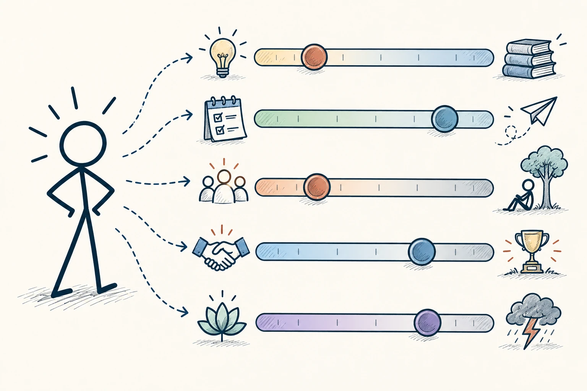
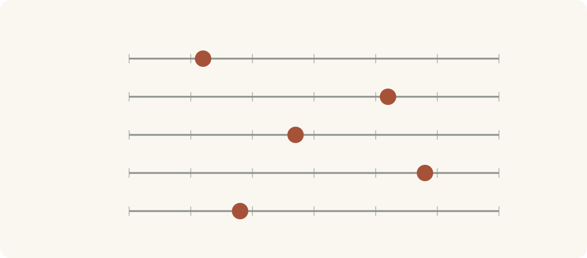

# 97 · 大五人格

Big Five Personality Traits · 行为与成长

> 人不像五种固定款式，更像在几条性格刻度上各有位置。

*配图说明：五个连续人格维度的滑杆：五条并列横向滑杆各有不同位置的滑块，同一个火柴人旁边形成其独特配置；每条两端用探索与熟悉、规划与随性、社交与独处、合作与竞争、平静与敏感的简洁图标。*

## 定义

大五人格用五个方向描述差异：对新事物的开放程度、做事的尽责程度、外向程度、宜人程度，以及情绪容易波动的程度。听着有点书面，可以理解成五根不同刻度，而不是五个只能选一个的盒子。

大五人格是一种用开放性、尽责性、外向性、宜人性与神经质五个连续维度描述人格差异的框架，每个维度还包含更细的侧面。

每个人在每根刻度上都有位置，也有更细的表现。内向不等于不会沟通，宜人不等于没有原则，尽责高也不代表永远不会拖延。性格描述的是较稳定的倾向，不能替代你在具体场景里观察一个人。

五个维度像五条独立刻度，不是五个只能选一个的盒子。一个人可以同时比较外向、比较尽责，也对新事物很开放；不能因为某一项突出，就把其他方面都猜出来。

*五个维度分别有自己的位置，组合起来才呈现一个人的差异。*

## 举个身边的例子

你发现自己参加大型聚会容易累，便认定“不适合任何需要沟通的工作”。但回看经历，你很擅长一对一理解需求，也能提前准备后作清楚的分享。

这个差别说明，你可能不喜欢持续高强度的社交刺激，却并非缺少所有沟通能力。了解倾向，可以帮助你安排休息、选择沟通方式，再练需要的技能，而不是凭标签提前关掉机会。

## 换个场景看看

一个做事很细的人在度假时也可能很随意，一个爱热闹的人也会需要独处。人有倾向，也受目标、关系和当天状态影响，别要求每次表现都与标签一致。

## 可以这样试

**什么时候用得上：** 理解相处差异、安排工作方式，或你被一个性格标签困住时，可以用它把人看得更细。

1. 把“我是某种人”改成“在某些情况下，我更倾向于……”。
2. 看多个场景和较长时间的表现，别只凭一次测试或一次心情。
3. 用了解到的倾向改善环境和合作，同时允许自己练习、改变和例外。

## 别用过头了

测试有误差，自评也可能受当时状态影响。“神经质”是某个维度的常见术语，不是骂人或诊断。性格结果不该用来给人定价值、限制机会。

## 花一分钟试试

把一个自我标签写成带情境的句子：“在……时，我通常……，但在……时也会不同。”看看它是不是更接近真实的你。

## 顺着看下去

- [96 · 智商与情商](076.md)
- [08 · 原型理论](013.md)
- [98 · DISC 行为风格模型](078.md)

## 来源与延伸

- [维基百科 · 大五人格](https://en.wikipedia.org/wiki/Big_Five_personality_traits)

---

例子为方便理解而设置，不是真实案例报道。
