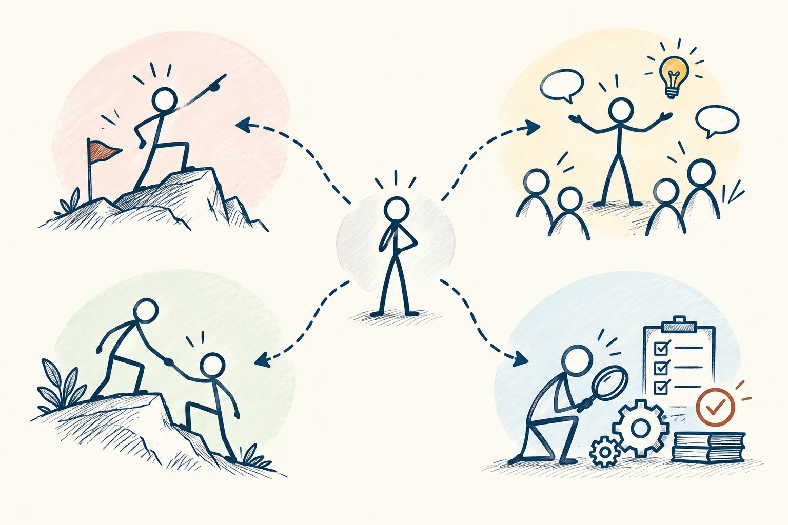

# 98 · DISC 行为风格模型

DISC · 行为与成长

> 可以借四种风格聊沟通，但别用四个字母给一个人定型。

*配图说明：四种行为倾向且可跨情境：四象限分别是直接推进、互动表达、稳定支持、谨慎检查的火柴人小场景，中央一个普通人通过虚线连向不同场景，表示行为随场景变化。*

## 定义

DISC在职场培训中常见，常把行为偏好概括为支配、影响、稳健、谨慎等方向，不同版本名称有差异。你可以先理解为：有些人想先看结论，有些人需要互动，有些人重稳定，有些人更关注依据和细节。

DISC是一组以支配、影响、稳健和谨慎或服从等维度描述行为风格的工具与框架，不同提供者的量表、命名和解释可能不同。

它的实用价值主要在于打开讨论：“你希望我怎样交代这件事？”而不是测试完就断定谁适合领导、谁天生不会合作。不同量表的质量与用途需要分别看，也不能把它与所有人格研究视作同一套证据。

四格可以帮助并列记忆行为倾向，但不要把它理解成人人都能被准确放进一个固定格子。不同工具的定义和量表可能不同，同一个人在不同任务或关系中，也会表现出不同做法。

*四种行为倾向可并列参考，同一个人会随情境表现出不同做法。*

## 举个身边的例子

你向同事汇报，一上来讲了二十分钟背景，对方一直问“所以你需要我决定什么”。你觉得他没耐心，他觉得你没有重点。换成开头先讲结论和所需决定，后面附背景与数据，双方就更容易接上。

这种调整甚至不一定需要知道彼此属于哪个字母。直接问“你喜欢先看摘要还是先看过程”，往往更准确。模型提供一组可能的偏好，真实对话才能确认这个人这次的需要。

## 换个场景看看

同一个人对熟悉任务可能想快点决定，对陌生事情却希望多看资料。偏好会随情境变化，不用因为“测出来不是这样”就拒绝听他当下的要求。

## 可以这样试

**什么时候用得上：** 团队想讨论沟通差异，却又说不清哪里不合拍时，可以借它开始，但最终回到具体行为。

1. 把风格词当作猜想，用实际问题向对方确认。
2. 沟通时试着调整顺序、细节和节奏，观察是否更方便合作。
3. 把有效偏好写成双方能遵守的小约定，而不是只记一个颜色或字母。

## 别用过头了

不要因为对方被分为“谨慎型”，就认定他胆小；也别因为“支配型”，就允许强势越界。标签不能替代行为标准和互相尊重。

## 花一分钟试试

问一位常合作的人：“我给你信息时，哪一种地方最费劲？”把回答改成一条具体调整，下次试一次。

## 顺着看下去

- [08 · 原型理论](013.md)
- [54 · 白金法则](038.md)
- [97 · 大五人格](077.md)

## 来源与延伸

- [维基百科 · DISC 行为风格模型](https://en.wikipedia.org/wiki/DISC_assessment)

---

例子为方便理解而设置，不是真实案例报道。
