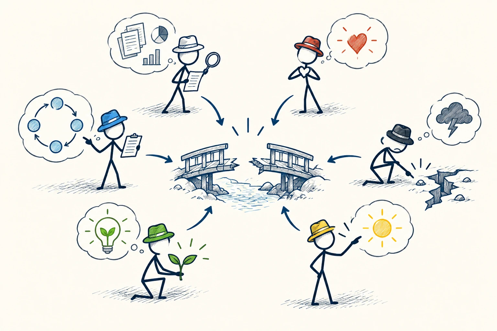
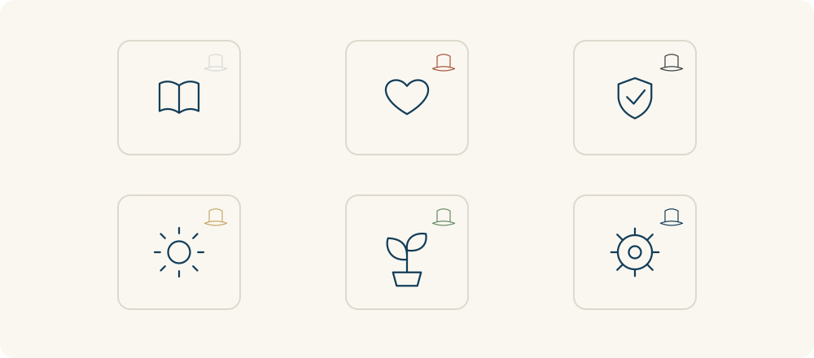

# 71 · 六顶思考帽

Six Thinking Hats · 工具与行动

> 讨论时先约好现在用哪种角度，别有人出点子、有人立刻泼冷水。

*配图说明：同一问题的六种视角：中央一座待修的小桥，外围同一组火柴人依次尝试六顶不同颜色帽子，白帽旁观察资料图标、红帽旁心形、黑帽旁风险裂缝、黄帽旁太阳收益、绿帽旁新芽创意、蓝帽旁组织流程环。*

## 定义

六顶思考帽用六种颜色代表不同关注点：白帽看事实，红帽说感受，黑帽找风险，黄帽看价值，绿帽想新办法，蓝帽安排讨论。你不用真的戴帽子，只需要让大家知道这一轮主要在做什么。

德博诺的六顶思考帽是一种平行思考方法，以白、红、黑、黄、绿、蓝六种帽子分别组织信息、感受、风险、价值、创意及过程管理。

它好用的地方在于，团队不再固定分成“乐观的人”和“挑错的人”。大家先一起想，再一起检查，既给创意一点生长空间，也给风险一个正式发言的时间。每种角度都有位置，不必靠抢话才能被听见。

六顶帽子适合平行摆开，让同一组人轮流换观察角度。它们不是六种固定人格，也不一定每次都按同一顺序使用；顺序应服务于当前讨论需要。

*六个视角围绕同一问题展开，同一组人可以轮流切换。*

## 举个身边的例子

几位朋友策划一次旅行，有人刚提出露营，就有人说下雨怎么办，另一人开始算钱，还有人只是觉得太累。每个人都在谈重要问题，却因为角度混在一起，越聊越像互相反对。

可以先用白帽确认日期、人数和预算，再用红帽说各自真正想要的感受；接着想几个方案，比较好处与风险，最后决定谁去查什么。顺序可以调整，重点是把混在一起的任务拆开，不急着给每个人贴立场标签。

## 换个场景看看

独自作决定也能用：先写我知道什么，再写感受，接着看好处与风险，最后想替代方案。把它们分栏，往往比在脑中同时吵架更清楚。

## 可以这样试

**什么时候用得上：** 头脑风暴总被打断、会议各说各话，或你自己反复在兴奋和担心间切换时，很好用。

1. 先说明这一轮要解决什么，用蓝帽负责时间和下一步。
2. 一次集中一种角度，轮到想方案时先记录，风险留到约定环节检查。
3. 结束前把事实、分歧、未知与负责人汇总，别只留一堆有趣想法。

## 别用过头了

不必每次按固定顺序用完六顶。紧急问题可能先排风险，事实不清则先查信息。这个框架帮你组织讨论，不会替你证明方案正确。

## 花一分钟试试

为一个小决定分六行写：事实、感受、风险、好处、新办法、下一步。每行只写一句，看看漏了哪个角度。

## 顺着看下去

- [04 · 马斯洛之锤](005.md)
- [45 · 金字塔原理](032.md)
- [66 · 5W1H 分析法](045.md)

## 来源与延伸

- [deBono · Six Thinking Hats Summary](https://www.debono.com/six-thinking-hats-summary)

---

例子为方便理解而设置，不是真实案例报道。
