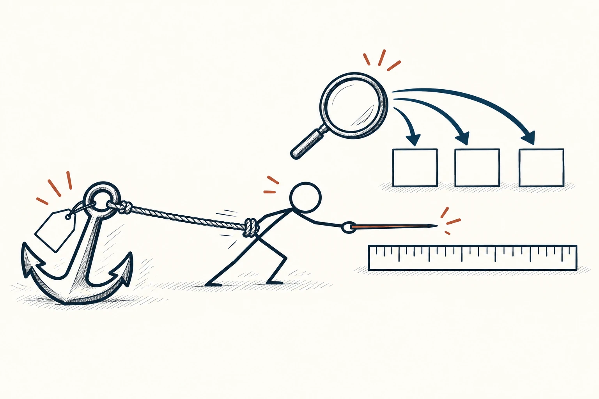
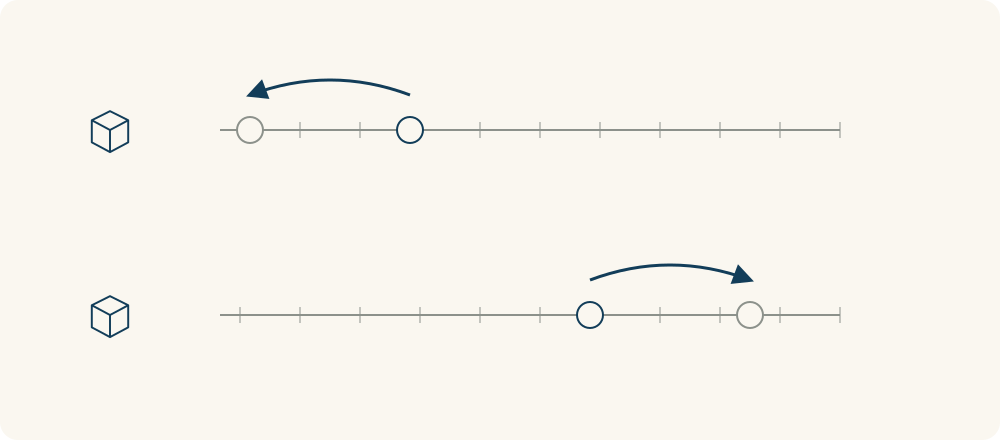

# 16 · 锚定效应

Anchoring Effect · 认知与推理

> 最先看到的数字，可能悄悄拉住后面的判断。

*配图说明：火柴人尝试在刻度尺上做独立估计，手腕却被连接到初始价格牌旁的重锚拉住；远处的放大镜指向可比对象。*

## 定义

你原本只打算买一个普通背包，先看见一款标价两千元的，再看到八百元的，就突然觉得“挺便宜”。但如果一开始看到的是两百元的，你可能会觉得八百元很贵。商品没变，先进入脑子的参照点却变了。

锚定效应指人在估计或判断时，过度依赖最初接触的数值或参照点，并且在获得后续信息后调整不足的倾向。

这个最先留下的参照点，就像船锚一样，把后面的估计拉向某个方向。它可能来自原价、别人先报的数字，也可能来自自己随口猜的答案。我们不是完全不看新信息，而是有时修正得还不够。

理解锚定效应后，可以先给自己找一个独立依据：同类东西通常什么价格，我真正需要什么，最多愿意付出多少。这样再看对方给出的数字，就更容易知道是在比较价值，还是只在比较谁离第一个数字更远。

比较时可以固定商品与条件，只改变最先出现的参照。两边对象相同，感受到的贵与便宜却可能不同；差异提示我们检查起点，而不是证明商品本身已经改变。

## 举个身边的例子

你想买一张书桌，页面写着“原价1999元，现在799元”。你觉得省了一大笔，甚至开始担心错过。但原价是否真的有人付过、同类书桌通常卖多少、尺寸是否适合你的房间，这些问题还没查。

先把“1999”暂时遮住，按尺寸、材质、稳固程度列出需要，再找三款功能接近的产品比较。最后问：如果页面只写799元，没有任何划线原价，我还愿不愿意买？你依然可以买，只是理由来自实际需要和比较，而不是被一个原价推着走。

*两行的对象和刻度相同。浅色点表示不同的起始参照，深色点表示受参照牵动的估计；位置只示意影响方向，不是实验数据。*

## 换个场景看看

团队讨论一个任务要花多久，第一个人说“两天差不多”，后面的人就容易围绕两天加减。可如果任务还有陌生环节，这个起点可能根本没有依据。

可以先让每个人独立写估计和理由，再一起拆任务、核对过去类似工作的用时。先独立判断不保证完全消除影响，但能减少大家只是在同一个数字旁边打转。

## 可以这样试

**什么时候用得上：** 买东西看折扣、讨论报价、估算时间，或发现自己总围绕某个先出现的数字加减时。

1. 先记下自己的需求、估计依据或可接受范围，再看对方提供的数字。
2. 找几组真正可比的外部信息，核对条件，而不只对比标价。
3. 把最初的数字暂时拿掉，重新问：只看事实，我会怎样判断？

## 别用过头了

先出现的数字不一定没有价值。有依据的历史价格、真实用时和明确预算都可以是合理参照。锚定效应提醒我们检查参照点是否可靠，不是要求故意反着选。一个判断受多种因素影响，也不能只凭最后的价格就断言某人被锚定了。

## 花一分钟试试

找一个让你觉得“很划算”或“太贵”的东西，写下你在和哪个数字比较。暂时遮住它，再用三条实际条件重新估一次。

## 顺着看下去

- [11 · 权威偏差](019.md)
- [12 · 可得性启发式](027.md)
- [47 · 框架效应](082.md)

## 来源与延伸

- [APA Dictionary · Anchoring Bias](https://dictionary.apa.org/anchoring-bias)

---

例子为方便理解而设置，不是真实案例报道。
