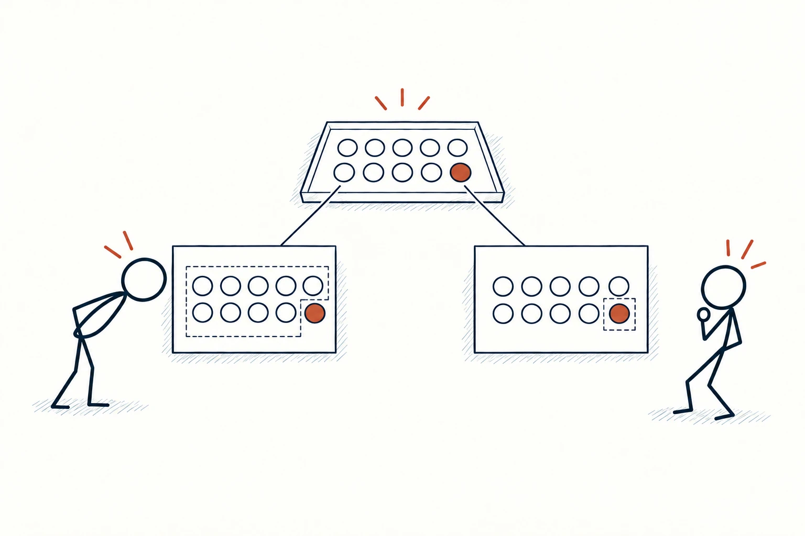
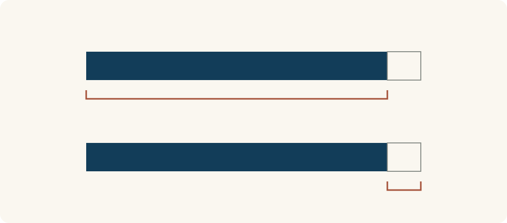

# 47 · 框架效应

Framing Effect · 沟通与影响

> 同一件事换个说法，我们的感受和选择可能跟着变。

*配图说明：同一盘十个圆点从两种取景框中被强调，左框关注九个普通点，右框关注一个砖红点；两位火柴人的反应不同，底层事实保持相同。*

## 定义

“十个人里有九个人完成了”，和“十个人里有一个人没完成”，讲的是同一组结果。但前一种说法容易让人注意成功，后一种容易让人盯着失败。框架效应关心的，就是呈现方式怎样影响我们理解同一件事。

框架效应指同一问题或等价选项因呈现方式、强调角度或描述框架不同，而引起判断与选择差异的现象。

我们不可能完全脱离表达方式来看信息：标题放什么、先讲好处还是代价、用人数还是比例，都可能让注意力落在不同地方。问题在于，自己可能以为是在根据完整事实选择，其实只看见了被强调的那一面。

一个实用办法是把同一信息换个方向再说一遍：有多少人完成，也有多少人没完成；能得到什么，也会付出什么。两种说法放在一起，通常比只换一个更好听的词更有帮助。

左右对比图应当使用同一组对象、同一分母与同一标准，只改变强调的位置。这样才能看清是表达角度在变化，而不是数据和条件被偷偷换掉。

## 举个身边的例子

一门课程的介绍写：“上一期100名学员中，90名完成了全部练习。”你觉得课程容易坚持。另一页写：“上一期100名学员中，10名没有完成全部练习。”你又开始担心自己坚持不下来。

如果讨论的是同一批人、同一个完成标准，两句话并不矛盾。先同时写成“90人完成、10人未完成”，再问练习需要多少时间、什么算完成、这些人和自己的情况是否相近。表达带来的感受可以保留，但决定还需要这些具体信息。

*两条总量和分段比例相同，上方强调完成的部分，下方强调未完成的部分。看见的重点变了，底层数量没有改变。*

## 换个场景看看

安排一个周末活动，你说“占用两小时”，朋友觉得被挤掉了休息；换成“剩下的时间仍可以自由安排”，听起来又宽松一些。如果活动时间相同，这只是把注意力移到了不同地方。

讨论时可以把完整安排摆出来：活动两小时，路程另算，哪些时段可自由安排。不是挑一种说法把对方劝进去，而是让双方在同一张时间表上做决定。

## 可以这样试

**什么时候用得上：** 阅读宣传、比较方案、讨论风险，或发现换一句说法就明显改变自己感受时。

1. 把描述还原成具体对象、数量、时间和条件，先确认两种说法是否真的等价。
2. 换一个互补角度重述：完成与未完成、收益与代价都写出来。
3. 依据自己的目标和完整条件作决定，别只追随某一句话带来的第一感受。

## 别用过头了

两句话听起来相近，不代表内容相同。“每月99元”和“一年1188元”还要核对是否必须年付、能否取消；条件不同就不只是框架差异。框架效应也不意味着所有表达都是操纵，清楚、完整的呈现本来就能帮助理解。

## 花一分钟试试

选一句让你心动或担心的介绍，写出它强调的一面和没有强调的一面。换一种说法后，事实变了吗？你的感受又变了多少？

## 顺着看下去

- [31 · 损失厌恶](028.md)
- [44 · 知识的诅咒](031.md)
- [16 · 锚定效应](081.md)

## 来源与延伸

- [APA Dictionary · Framing](https://dictionary.apa.org/framing)

---

例子为方便理解而设置，不是真实案例报道。
