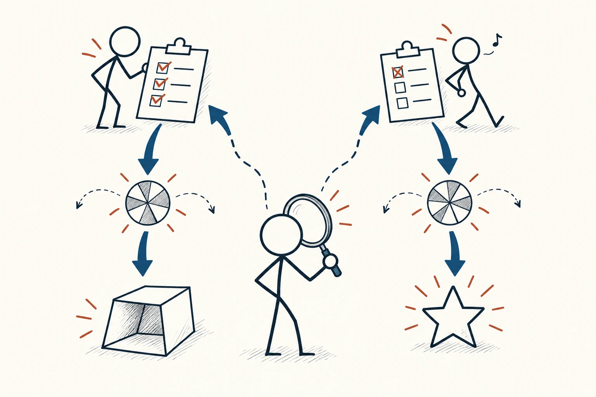
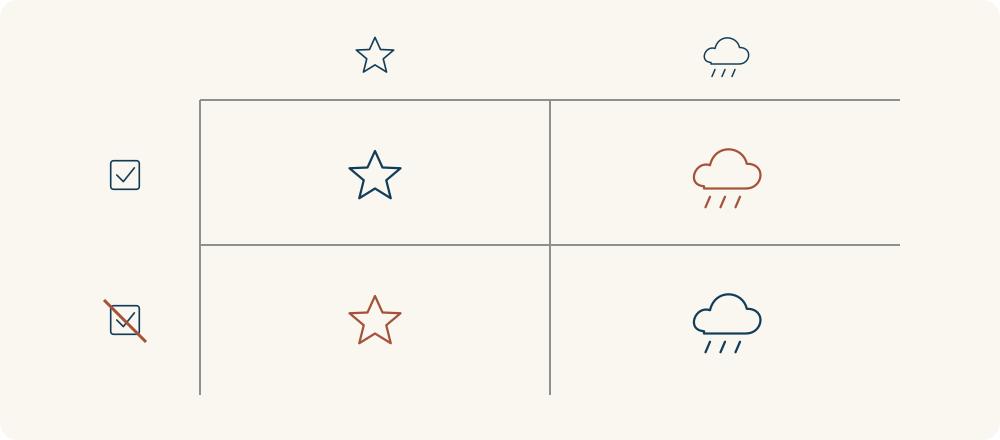

# 40 · 结果偏差

Outcome Bias · 选择与决策

> 一次结果好，不代表当时的决定一定做得好。

*配图说明：认真核对的计划与跳过检查的计划各经过不确定性转轮，前者出现不理想结果、后者碰巧得到星星；火柴人用放大镜回看原始决策过程。*

## 定义

有人出门前看了天气、留了时间，仍碰上突发交通中断而迟到；另一个人毫无准备，却因为路上特别顺利按时到达。如果只看“谁到了”，我们可能把认真准备说成没用，把侥幸成功当成好方法。

结果偏差指人在已知结果后，受到结果好坏的影响而评价决策质量，未充分区分决策时可用的信息与事后出现的偶然因素。

判断一个决定，应该先回到当时：有哪些信息能知道，哪些风险可以预见，有没有合理比较方案？再单独检查结果为什么发生。这样才能分清是方法需要改进，还是在合理准备后仍遇到了意外。

结果当然重要。只是一次成功或失败，很难独自解释整个过程。把过程与结果放在一起看，才能既不拿坏运气责怪所有人，也不因为碰巧成功就奖励冒险做法。

四格图可以把“过程是否合理”和“结果是否理想”分成两个轴。合理过程也可能遇到坏结果，糟糕过程也可能暂时走运；评估时要同时检查两条轴，不能把它们合成一条。

## 举个身边的例子

你和同事分别准备两场线上分享。你提前测试设备并准备了备用文件，现场却碰到临时断网；同事没有测试，设备刚好顺利运行。复盘时，有人说：“看吧，准备这么多也没用。”

更有帮助的复盘是分开检查：你的测试是否覆盖了可预见问题，断网后备用安排是否起作用，下次还有什么合理改进？同事这次顺利，也不说明以后可以跳过检查。一次活动的结果可以提供线索，但不能把所有准备都判成浪费。

*行区分过程是否合理，列区分结果是否理想。砖红标出容易误判的两格：合理过程遇到坏结果，或不合理过程碰巧成功。*

## 换个场景看看

团队采用同一种合理的筛选流程，选中的两名新人后来表现一好一差。单看结果，容易认为一份决定英明、另一份完全失误。

可以先比较当时掌握的信息、评价标准与是否遗漏了可查证的问题，再用后续表现改善流程。如果同类失误持续出现，就应修改标准；不能用“只是运气”把反复出现的信号都挡掉。

## 可以这样试

**什么时候用得上：** 项目复盘、评价他人决定，或因为一次成功就想复制全部做法、一次失败就想推翻全部流程时。

1. 先记录决策当时的目标、证据、备选方案和已知风险，再看最终结果。
2. 把结果中的可控因素与意外因素分开，核对是否存在当时就能发现的遗漏。
3. 保留有效过程，修改可改进环节，并持续观察多次结果是否支持原来的判断。

## 别用过头了

区分运气与能力很难，不能靠一句“结果不代表过程”免除责任。明知重要风险却不处理，与尽力准备后遇到无法预见的变化不同。连续出现的问题也是证据，应当用于更新流程，而不是被当成偶然一笔带过。

## 花一分钟试试

想一件最近成功或失败的事。先遮住结局，列三条当时作决定的依据，再问：如果结局相反，我会不会突然把同一套依据评价成另一种样子？

## 顺着看下去

- [10 · 幸存者偏差](018.md)
- [23 · 均值回归](024.md)
- [39 · 二阶思维](058.md)

## 来源与延伸

- [Baron 与 Hershey · Outcome Bias in Decision Evaluation](https://bear.warrington.ufl.edu/brenner/mar7588/Papers/baron-hershey-jpsp1988.pdf)

---

例子为方便理解而设置，不是真实案例报道。
