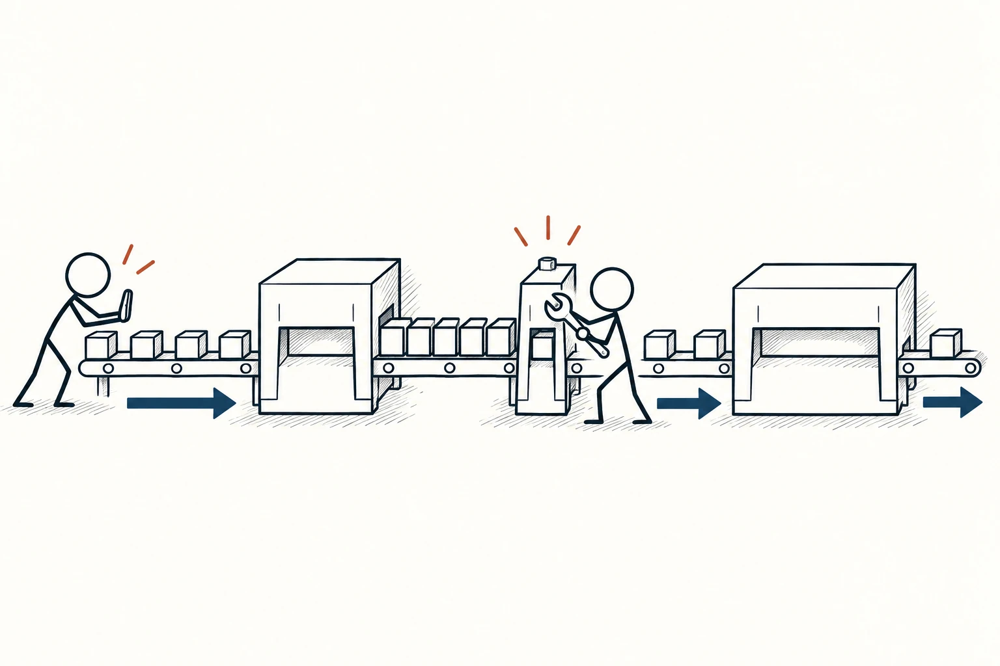
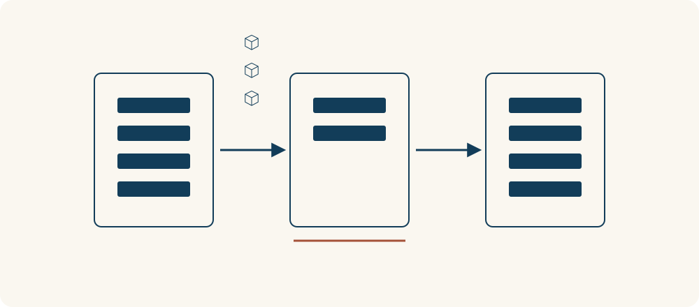

# 80 · 瓶颈理论

Theory of Constraints · 系统与规律

> 整条队伍走多快，往往取决于最卡的那个环节。

*配图说明：不同宽度的流程通道中，只有中央狭窄环节前堆着任务方块；火柴人调整中央闸口，其他环节围绕它配合，强调整体流量。*

## 定义

一条做事流程里，每个人都很忙，不代表最后完成得多。前面不断接任务，中间只有一个人能审核，后面的人只能等；继续催前面加速，可能只会让待审核的东西堆得更高。

瓶颈理论通常对应约束理论：围绕系统目标识别限制整体产出的关键约束，协调其他环节并改善约束，再持续检查新的限制所在。

瓶颈理论提醒我们先问整体卡在哪里：不是哪个人看起来最慢，而是哪个限制真正挡住了最终交付。限制可能来自机器、人员、排班、审批规则，甚至是团队对优先级的约定。

找到限制后，先减少它被打断和做无效工作的时间，再考虑增加能力。其他环节也要配合，不要为了自己显得高效而制造更多积压。一个瓶颈改善后，新的限制还可能出现在别处，所以这是一轮轮调整的过程。

流程图可以把进入量、处理能力和等待位置放在一起看。真正的瓶颈会限制整体通过量；前后步骤单独提速，未必增加最终交付，反而可能让等待变多。

## 举个身边的例子

一家小咖啡店每小时能接40杯订单，打包也能处理40杯，但咖啡机每小时最多做20杯。只增加收银速度，并不能让店里每小时交出40杯咖啡，反而会让更多顾客排队等待。

可以先保证咖啡机不断料、清洁和换班安排合理，减少返工；接单时说明等待时间，并考虑预约或限制同一时段订单。若需求持续存在，再评估增添设备是否值得。改善后也要继续观察：如果打包开始积压，瓶颈可能已经转移。

*各框内的条数示意处理能力，中央环节较少，任务就在它之前积压。增加前端输入不等于增加最终交付。*

## 换个场景看看

你准备发布文章，写作一天能完成三篇，排版能完成四篇，但审核每天只能处理一篇。团队要求所有人“再快一点”，可能只会堆出更多半成品。

先把待审材料补齐、集中处理同类问题、明确审核时段，减少审核者反复追问。用最终发布量和等待时间检查改进，而不是只数每个人手里做了多少事情。

## 可以这样试

**什么时候用得上：** 任务积压、上下游互相等待，或大家都很忙但整体完成量仍然上不去时。

1. 画出从开始到最终交付的流程，记录每一步的处理能力、等待和积压。
2. 找到真正限制整体目标的环节，先减少它的空等、返工和无关打断，让其他步骤配合。
3. 改善后看整体交付是否增加，并重新寻找限制，不把过去的瓶颈当成永远的答案。

## 别用过头了

耗时最长的步骤不一定就是瓶颈，要结合需求量、并行能力与实际积压判断。有些流程有多个约束，也有波动和质量要求；不能只追求速度而牺牲安全与质量。约束理论比“找最慢的人催一下”更广，重要的是整个系统的目标。

## 花一分钟试试

画出一件常做的事的四到六个步骤。标出哪里最常排队，再写一条能减少该处等待或返工的小改动。

## 顺着看下去

- [69 · 二八法则与帕累托原则](056.md)
- [77 · 反馈回路](066.md)
- [78 · 收益递减规律](067.md)

## 来源与延伸

- [Lean Enterprise Institute · Theory of Constraints](https://www.lean.org/lexicon-terms/theory-of-constraints/)

---

例子为方便理解而设置，不是真实案例报道。
