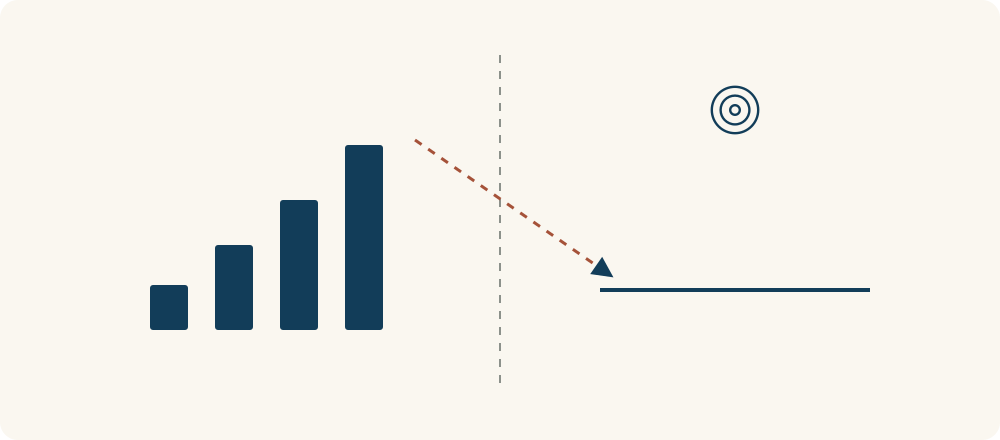

# 81 · 古德哈特定律

Goodhart’s Law · 系统与规律

> 只盯着把数字做好，可能把真正想做的事带偏。

*配图说明：火柴人追逐不断抬高的刻度条，弯曲箭头却偏离旁边真正的靶心；另一位用放大镜核对指标与目标的距离。*

## 定义

你想养成阅读习惯，于是规定自己每天必须读五十页。刚开始，这个数字能提醒你打开书。后来为了完成任务，你开始挑字少的页面，遇到难懂的内容就翻过去。页数很好看，理解却没有跟着增加。

古德哈特定律提醒我们：原本用于观察目标的指标，在被强力用作考核或控制目标后，人们的适应与优化行为可能削弱它代表真实目标的能力。

页数原本只是了解阅读情况的一条线索。一旦奖励、评价或自我满足全绑在页数上，行为就可能围着数字转。古德哈特定律提醒我们检查：这个数字变好时，我们真正关心的东西也在变好吗？

问题不在于所有指标都没用，而在于把代理信号当成最终目的。可以用数字发现变化，再结合质量、真实反馈和有没有副作用一起判断，让指标帮助我们观察，而不是替我们定义全部价值。

对比图应当让“数字表现”和“真实效果”各有位置。两边可能一起改善，也可能分开走；重点是核对它们之间的联系，而不是预设所有数字都在骗人。

## 举个身边的例子

一个客服团队希望更及时地帮助用户，于是考核“每人每天关闭多少工单”。后来有人把复杂问题过早关闭，或让用户重新提交。关闭数量增加了，用户的问题却可能仍没解决。

先把真正目标写清楚：用户的问题得到合适解决，等待也不过长。再一起看是否解决、是否重复求助、用户反馈与处理时长，并抽查具体案例。多加几个数字也不是万能办法，仍要观察大家会怎样适应这些规则。

*左侧记录量上升，右侧真实效果却可能停在原处；先核对二者的联系，再判断数字变好是否代表目标实现。*

## 换个场景看看

你把“读完多少个思维模型”当成学习成绩，可能很快把87篇都点成已读，却说不出其中一个如何用在现实里。已读数量记录了浏览情况，不能独自证明理解程度。

可以保留进度条，再给自己加一个更贴近目标的小动作：选一个模型写生活例子，过几天合上页面再解释一次，或记录一次实际使用后的调整。真正有帮助的是思考方式发生了什么变化。

## 可以这样试

**什么时候用得上：** 考核数字越来越好，但用户体验、质量或真实能力没有同步改善，或者大家开始研究怎样“完成指标”时。

1. 先用一句话写真正目标，再说明当前指标为什么能代表它，以及可能漏掉什么。
2. 想想怎样只改善数字却不改善目标，主动找容易被钻空子或造成副作用的地方。
3. 结合质量反馈与具体案例检查指标，允许修订规则，并持续观察行为是否被带偏。

## 别用过头了

它不是所有指标必然失效的物理定律，也不是反对记录数据。指标是否有用取决于目标、激励、环境与检查方式。常见的“指标成为目标就不再是好指标”是后来广泛流传的概括；使用时更适合把它当作检查风险的提醒。

## 花一分钟试试

选一个你常追求的数字，例如页数、打卡天数或任务数量。写下真正目标，再列一种“数字变好但目标没变好”的情况，想一个核对办法。

## 顺着看下去

- [39 · 二阶思维](058.md)
- [86 · 正强化与负强化](060.md)
- [77 · 反馈回路](066.md)

## 来源与延伸

- [剑桥大学 Michael McIntyre · Goodhart’s Law 与表述来源](https://www.damtp.cam.ac.uk/user/mem2/papers/LHCE/goodhart.html)

---

例子为方便理解而设置，不是真实案例报道。
