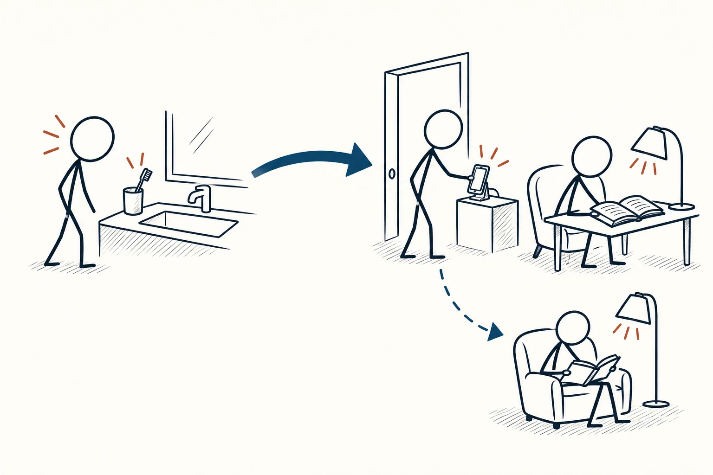
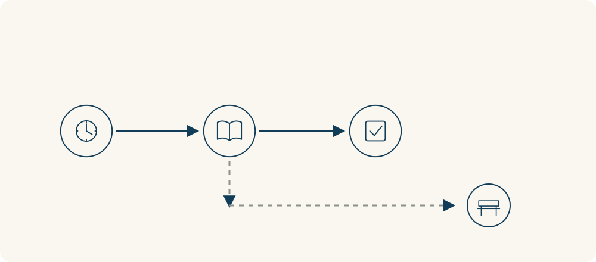

# 72 · 执行意图

Implementation Intentions · 工具与行动

> 提前说清楚：遇到什么情况，我就做什么。

*配图说明：一个火柴人站在清晰的门槛线索旁，沿藏蓝箭头自然走向打开的书和台灯；遇到障碍时，一条简洁的备用路径接到可行动的小步骤。*

## 定义

“以后多运动”“有空就读书”，听起来都很认真，真正到了晚上，却常常不知道从哪一刻开始。执行意图把愿望往前推进一步：不是只说想做到什么，而是提前约定在什么情况下，自己具体做哪个动作。

执行意图是一种把目标转化为行动的计划方式：预先将具体情境线索与相应行为连接起来，形成“如果出现情境，就执行某个动作”的安排。

比如“晚饭后把碗放进水槽，我就换鞋下楼走十分钟”。这里有能认出来的线索，也有足够明确的行动。等到那一刻，不必再临时决定今天做不做、先做什么，开始就有了一个比较清楚的入口。

同样的方式也可以应对障碍：“如果到了下楼时间还在下雨，我就在家做一段合适的活动。”计划不是为了控制所有变化，而是先替容易卡住的那一步作安排。

流程图从一个可识别的线索开始，接到一个具体动作；如果有常见障碍，可以另外接一条简单备用路径。图里的关键是“什么时候开始、开始做什么”，不是把整个生活都排成复杂流程。

## 举个身边的例子

你想每晚读书，却总在刷手机时把这件事忘掉。可以把计划写成：“晚上刷完牙，把手机放到客厅充电后，我就在床边读两页。”书提前放在能拿到的地方，两页也容易知道何时完成。

试几天后发现刷牙时间常常太晚，就调整线索，改成晚饭收拾完之后。计划要跟实际生活接得上；如果每天都在同一个地方失败，先检查条件和动作是不是合适，而不是只责怪自己没毅力。

*先识别线索，再做一个具体动作并核对完成；下方虚线表示遇到常见障碍时可以预先安排的备用动作。*

## 换个场景看看

开会时有人突然提反对意见，你容易马上抢着解释。可以提前约定：“如果我听到反对意见，就先记下对方的一个具体担忧，再用一句话核对自己的理解。”

这不能保证对话顺利，也不会让情绪立刻消失，但给了自己一个能练习的替代动作。会后看有没有做到，再决定是否需要把动作改得更简单。

## 可以这样试

**什么时候用得上：** 目标清楚但总是忘记开始、临场犹豫，或在固定情境下反复做出不想要的反应时。

1. 选一个自己真正愿意做的小目标，找出最容易卡住的具体时刻。
2. 写成“如果出现这个线索，我就做这个动作”，确保线索能认出、动作能执行。
3. 准备必要物品并试一段时间，根据记录调整线索或动作，必要时安排一个简单备用方案。

## 别用过头了

它不能替代目标意愿、能力、时间和资源。线索太模糊、动作太大，或者目标根本不适合自己，都可能让计划落空。不要同时写几十条规则，也别因为一次没做到就认定无效；要看安排是否合理、现实障碍是什么。

## 花一分钟试试

补完一句话：“如果________，我就________。”把后半句缩成一个今天就能做的小动作，并检查触发时需要的东西是否已准备好。

## 顺着看下去

- [64 · 最小可行产品](043.md)
- [65 · 最小有效剂量](044.md)
- [70 · 帕金森定律](069.md)

## 来源与延伸

- [Gollwitzer 与 Sheeran · Implementation Intentions](https://cancercontrol.cancer.gov/brp/research/constructs/implementation-intentions)

---

例子为方便理解而设置，不是真实案例报道。
