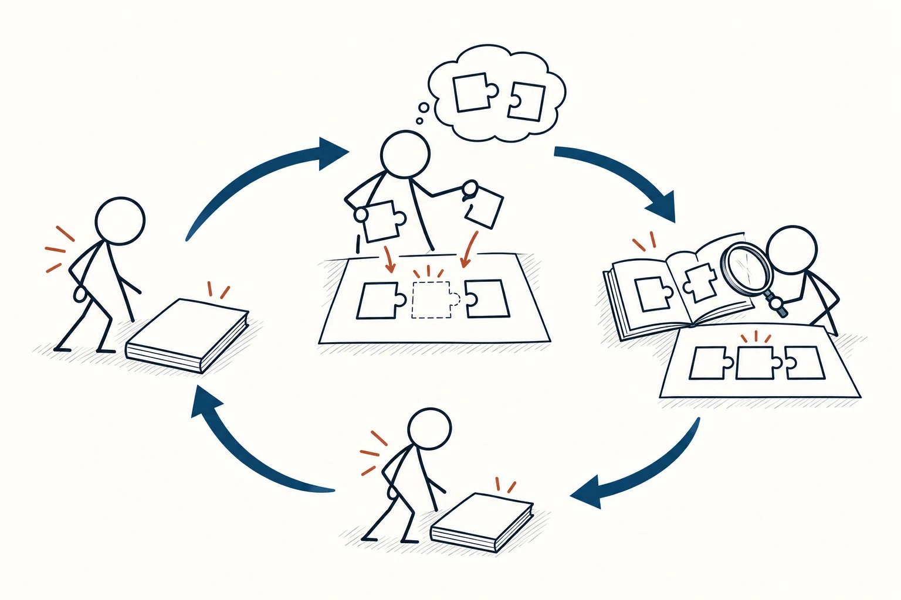
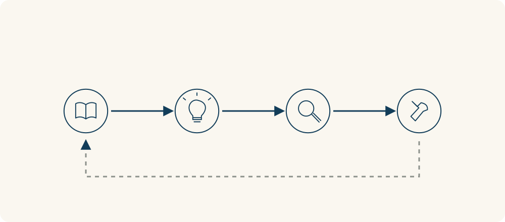

# 99 · 主动回忆

Retrieval Practice · 行为与成长

> 合上书，试着自己说出来，再看看漏了什么。

*配图说明：火柴人把书轻轻合上，从脑中取出几块信息拼图放到空白纸上，再打开书用放大镜核对缺失的一块；一条轻巧回路连接提取、核对与再次尝试。*

## 定义

读一段内容时，你可能觉得每句话都懂；合上页面让自己讲一遍，却突然说不清楚。这不一定是你不适合学，而是“看着觉得熟悉”和“能从记忆里拿出来”，本来就不是一回事。

主动回忆又称提取练习，是在暂时不查看材料的情况下，从记忆中提取已学信息，并通过核对与反馈巩固学习的练习方式。

主动回忆让学习多一个提取过程：先不看答案，试着解释、写要点或解决问题，再回到材料核对。它既能帮你发现哪里只是眼熟，也把提取本身变成练习的一部分。

不必把它变成紧张考试。可以先回忆一个小段落，允许遗漏，再把没想起或想错的地方补回来。重点是认真尝试提取，并用反馈修正，而不是追求第一次就把原文背得一字不差。

循环图可以分清“先不看材料尝试回忆”和“之后打开材料核对”两步。核对结果用来修正下一轮练习；不是一边看答案一边觉得自己已经记住了。

## 举个身边的例子

你刚看完“沉没成本”，觉得“过去花掉的钱不该决定下一步”很容易。关掉页面后，试着回答：什么付出算拿不回来的？能退款的费用要不要考虑？继续一件事什么时候仍然合理？

把自己的回答写下来，再打开内容核对。如果只记住“不要坚持”，就补上遗漏：该比较的是从现在开始的收益与代价，有未来价值仍然可以继续。过几天换一个生活例子再解释，比只盯着熟悉的一句话更能检验理解。

*先接触材料，再不看材料尝试提取，之后核对和修正，隔一段时间再练。提取与核对要分开，不能一开始就照着答案读。*

## 换个场景看看

你在学一个工作流程，重看操作说明时觉得很熟。可以在安全的练习环境中关掉说明，先写出关键步骤，再尝试完成一遍，最后核对遗漏和错误。

如果涉及危险或重要操作，不要为了“凭记忆”跳过正式检查清单。学习练习与实际执行的要求不同，清单依然是减少失误的工具。

## 可以这样试

**什么时候用得上：** 读完书或课程后想检查自己是否真懂、准备复习，或发现“看着会，离开材料就不会”时。

1. 学完一个小块后暂时合上材料，用问题、空白纸或自己的话把内容想出来。
2. 再打开材料核对，明确哪处遗漏、误解或证据不足，及时修正。
3. 隔一段时间换问题或换场景再提取，把间隔复习与应用结合，避免只记住固定答案。

## 别用过头了

主动回忆不等于机械背诵，也不能替代最初的理解、必要讲解和实际练习。内容完全没学懂时，可以先回去补基础，再缩小练习范围。不要长期重复未经核对的错误；练习难一点可以，但不必把痛苦当成学习有效的证据。

## 花一分钟试试

先合上这个页面，用自己的话写出“主动回忆和反复重看的区别”，再举一个你今天能练的内容。写完后回来核对，补一处遗漏。

## 顺着看下去

- [44 · 知识的诅咒](031.md)
- [89 · 遗忘曲线](063.md)
- [72 · 执行意图](086.md)

## 来源与延伸

- [加州大学圣迭戈分校心理系 · Retrieval Practice](https://psychology.ucsd.edu/undergraduate-program/undergraduate-resources/academic-writing-resources/effective-studying/retrieval-practice.html)

---

例子为方便理解而设置，不是真实案例报道。
