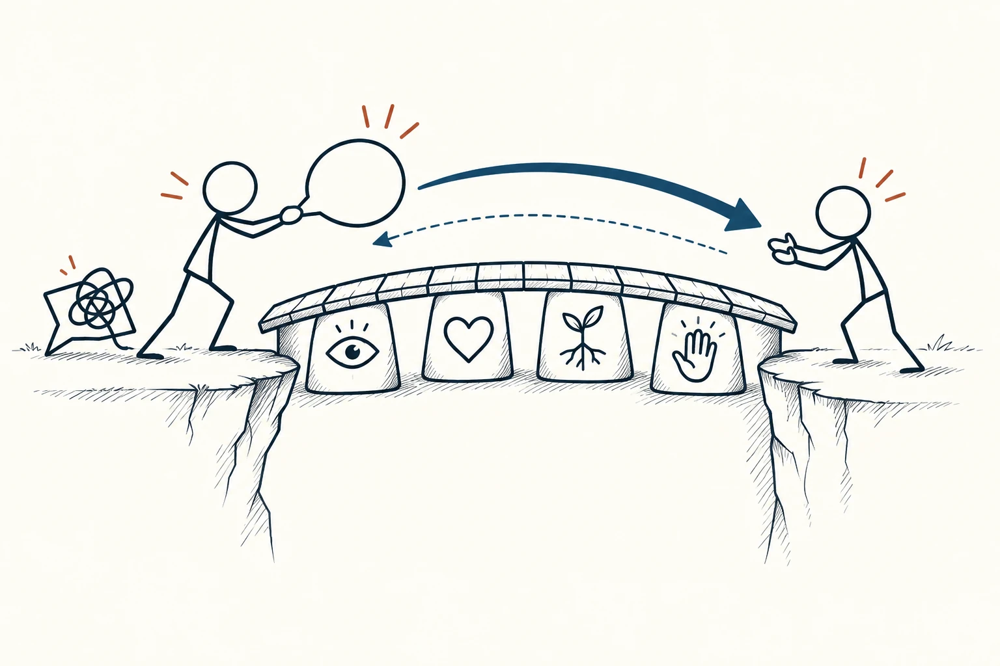
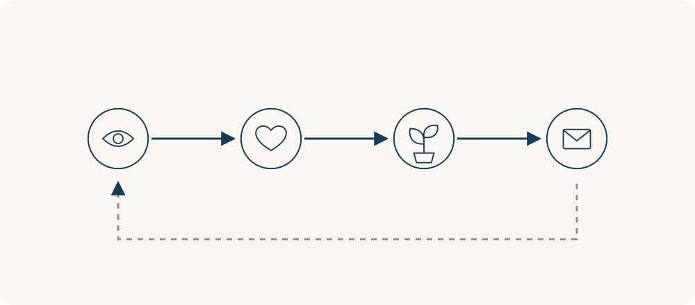

# 48 · 非暴力沟通

Nonviolent Communication · 沟通与影响

> 把事实、感受、需要和请求说清楚，比一句指责更容易让人听见。

*配图说明：两位火柴人在平等位置交流，尖锐对话气泡被放下，圆润气泡经过由观察、感受、需要和请求图标支撑的小桥；返向细箭头表示听取回应。*

## 定义

“你总是这么不负责。”一句话说出口，对方可能还没弄清发生了什么，就已经开始解释或反击。非暴力沟通想帮助我们把这句话拆开：具体发生了什么，我有什么感受，我在意什么，以及希望对方接下来做哪件事。

非暴力沟通是由马歇尔·卢森堡发展的一种沟通框架，强调区分观察与评价，辨认感受和需要，并提出具体、可回应的请求，同时理解对方的感受与需要。

比如“我看到这两次资料都晚于约定时间发来，我有点着急，因为我需要留出核对时间。下次如果赶不上，能否提前告诉我预计几点能交？”这段表达没有保证对方一定答应，但给了双方讨论事实和安排的入口。

常见的四个部分是观察、感受、需要和请求。观察尽量具体，感受说自己的情绪，需要说明自己重视的东西，请求则落在一个可执行的动作上。它们是帮助理清意思的线索，不是每次说话都要背完的固定句式。

听别人说时，也可以试着核对：“你是不是担心时间不够，希望先确认哪些最重要？”这里是在询问，不是替对方断言他的真实想法。表达自己和理解对方，需要来回确认。

四步图可以把事实、情绪、需要和动作分开。顺着图检查表达里有没有混入指责，再留一个返回的位置给对方回应；图的目的不是把请求变成对方必须执行的命令。

## 举个身边的例子

你和同事约好下午三点前交资料，这两次都在四点后才收到。你原本想说“你每次都拖后腿”，后来改成：“这两次约定三点，我都在四点后收到。我要赶五点的汇总，现在有点着急。我需要至少半小时检查。今天能先告诉我哪些部分已经完成吗？”

同事可能说他同时接到更急的任务。接下来可以讨论先交关键部分、调整分工或重新约时间。如果对方暂时做不到，你仍可以说明自己的时间限制，并把需要协调的事情交给相关负责人。把指责换成请求，不等于放弃责任和边界。

*从左往右分别检查：观察到什么、自己有什么感受、在意什么需要、提出什么具体请求。返回的虚线提醒我们还要听取并核对回应。*

## 换个场景看看

家人晚上把电视开得很响，你忍不住想说“你根本不考虑我”。可以先说具体情况：“现在声音传到卧室，我还没睡着，有些烦躁，想安静休息。你愿意调低音量或戴耳机吗？”

对方也许想放松，未必意识到声音会传过去。双方可以一起找可行安排。如果你说“我感觉你很自私”，虽然加了“我感觉”，后面仍是对人的评价；把评价和自己的情绪分开，讨论才更容易继续。

## 可以这样试

**什么时候用得上：** 想表达不满、提出需求、讨论分工，或发现对话一开口就变成互相指责时。

1. 先说能核对的具体事情，尽量去掉“总是”“从来不”和对人格的评价。
2. 辨认自己的感受与需要，再用一句话提出具体、可执行的请求。
3. 听取对方的回应并核对理解，讨论可行安排；做不到时明确边界或寻求协调。

## 别用过头了

它不是让别人按你的意思做的技巧，也不是要求你永远温柔、压住愤怒或公开隐私。请求允许对方拒绝和协商，不能换一套句式来包装威胁。面对持续伤害或明显不安全的处境，先保护自己、拉开距离或寻求支持，比坚持完整说完四步更重要。

## 花一分钟试试

写一句你最近很想说的抱怨。分别圈出事实和评价，再补上自己的感受、在意的需要，以及一个可以讨论的小请求。

## 顺着看下去

- [43 · 神奇比例](030.md)
- [54 · 白金法则](038.md)
- [49 · 推论阶梯](089.md)

## 来源与延伸

- [非暴力沟通中心 · 非暴力沟通的目的](https://www.cnvc.org/about/purpose-of-nvc)
- [PuddleDancer Press · 非暴力沟通四个组成部分](https://www.nonviolentcommunication.com/pdf_files/4part_nvc_process.pdf)

---

例子为方便理解而设置，不是真实案例报道。
