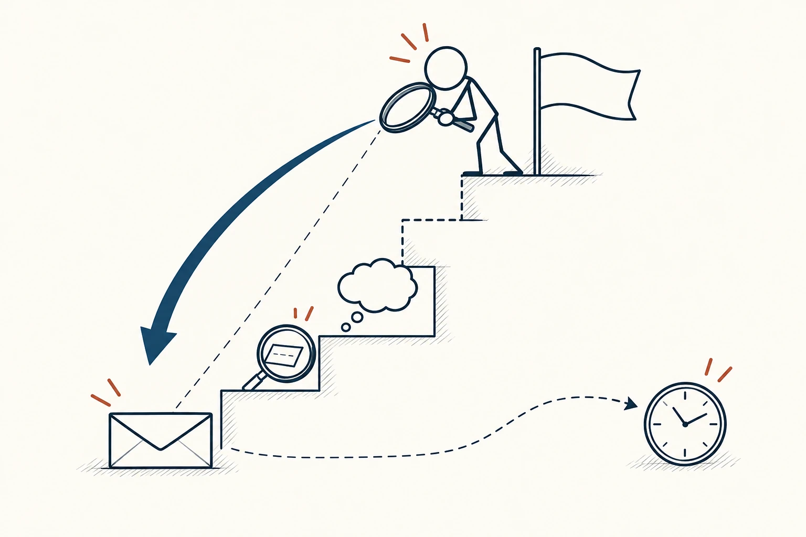
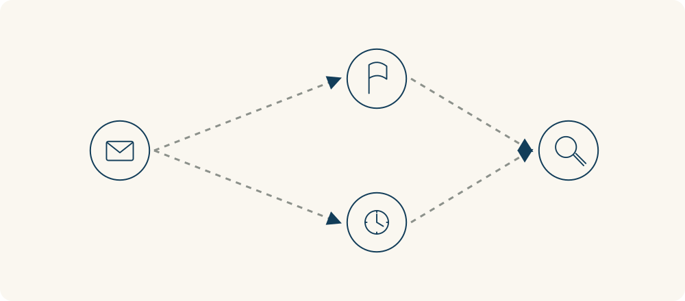

# 49 · 推论阶梯

Ladder of Inference · 沟通与影响

> 从“我看见了什么”到“我认定他是什么人”，中间可能跳过了好几步。

*配图说明：火柴人站在由信封、选择信息、解释与结论构成的阶梯上，上方连接用虚线提示假设；他回头用放大镜检查底部信息，另一个时钟分支表示其他解释。*

## 定义

你发消息给同事，他半天没回。你先注意到“没回复”，接着想“他是不是故意不理我”，然后认定“他根本不重视合作”，最后决定下次也不主动帮他。一次观察，就这样一路变成了对人的判断和自己的行动。

推论阶梯是一种检视推理过程的框架，描述人如何从可观察的信息中作选择、赋予意义、加入假设，进而形成结论、信念并采取行动。

推论阶梯把这段常常很快发生的过程慢放出来。底层是能观察到的信息，往上是我们挑了哪些信息、怎样解释、补了什么假设，再往上才是结论和行动。不同人看到同一件事，可能因为挑选和解释不同，走到了不同的结论。

使用它时，重点不是指责别人“你在脑补”，而是先检查自己：“我真正知道什么？哪一步是猜的？还有什么解释？”把这些过程说出来，对方才有机会补充你不知道的信息。

它和二阶思维的方向不同：二阶思维往后看一个行动会引起什么影响；推论阶梯往回检查自己怎样从信息走到当前判断。前者看后续变化，后者看解释过程，两者可以一起使用。

阶梯图中，下层放可观察的信息，上层放解释、假设和结论。向上容易把猜测当事实，向下核对则可以发现缺口；这些层级表示推理关系，不表示地位或能力高低。

## 举个身边的例子

会议上你提出方案，一位同事皱眉并看了一眼手机。你觉得他不认同，也不尊重你的准备，于是解释得越来越急。回到事实层，只能确定你看到了皱眉和看手机，并不能直接知道他在想什么。

可以先问：“刚才这个安排有什么让你担心的地方吗？”对方也许确实不同意方案，也许正在看另一条紧急通知。得到回应后，再讨论具体问题。你不必提前认定自己误会了，只要让结论接受核对，而不是把表情直接当成态度的证明。

*左侧是一条观察，分支表示不同解释；右侧的放大镜代表核对信息。虚线提醒我们，这些解释在核实前都还只是可能。*

## 换个场景看看

客户说“再考虑一下”，销售人员认定是价格太高，立刻大幅让价。可客户真正没有确定的，可能是交付时间、使用条件，或者是否需要这项服务。

先把事实写成“客户暂时没有决定”，再问：“你还希望确认哪些信息？”这样可能发现需要补充的内容，也可能确认价格确实是障碍。检查推断不是拖延行动，而是避免根据没核实的原因采取错误动作。

## 可以这样试

**什么时候用得上：** 对别人的态度很快下了结论、同一件事总谈不拢，或想知道双方究竟从哪一步开始理解不同时。

1. 把自己能直接观察和核对的事情写出来，先去掉动机、性格和意图判断。
2. 沿着解释过程往回查：我挑了哪些信息，加入了什么假设，还有什么可能？
3. 用中性问题补充信息，并说清自己的理解过程，再根据回应调整判断和行动。

## 别用过头了

它是反思和对话的工具，不是大脑必然逐级运行的精确地图；实际理解可能来回跳转。也不要拿它要求别人不断证明自己的感受。有明确证据和重复行为时，应当认真处理责任与边界，而不是永远把问题退回“可能只是误会”。

## 花一分钟试试

挑一个最近让你不舒服的判断，画三栏：“看到的事”“我的解释”“还缺的信息”。只根据第一栏，写一个能核对情况的问题。

## 顺着看下去

- [05 · 批判性思维](007.md)
- [14 · 确认偏误](035.md)
- [60 · 汉隆剃刀](080.md)

## 来源与延伸

- [哈佛商学院在线 · 推论阶梯及使用例子](https://online.hbs.edu/blog/post/ladder-of-inference)

---

例子为方便理解而设置，不是真实案例报道。
