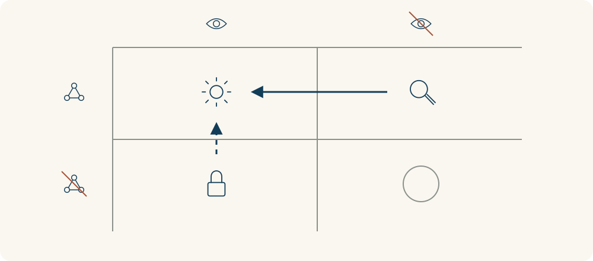

# 50 · 乔哈里视窗

Johari Window · 沟通与影响

> 我以为的自己，和别人看到的我，可能不是同一幅图。

*配图说明：两位火柴人围绕半开的共享视窗交换拼图，一人指出另一人背后没看见的小补丁，另一人手中保留带盾牌的私人盒子；虚线表示自愿分享，细箭头表示反馈。*

## 定义

你以为自己开会很积极，同事却觉得经常被打断；你以为别人知道自己不擅长临时发言，实际上从来没有告诉过他们。沟通里有些差异，来自双方掌握的信息不同，而不只是某个人表达得不好。

乔哈里视窗是一种人际认知框架，将信息按“自己是否知道”和“他人是否知道”分为公开区、盲区、隐藏区和未知区，用来讨论反馈与适度自我表达。

乔哈里视窗用两个问题把这些信息分成四块：我知道吗？别人知道吗？双方都知道的是公开区；别人看到、我没意识到的是盲区；我知道但暂时没告诉别人的是隐藏区；双方都还不了解的是未知区。这里的“别人”，要放在具体关系和场景里理解。

听取具体反馈，可能让盲区的一部分变成双方都知道的信息；适度说明自己的情况，也可能让隐藏区的一部分进入公开区。新的任务或经历，还可能让以前没人注意到的能力和限制浮现。

公开区变大并不是越多越好，更不等于把所有隐私都交出去。它真正有用的地方，是帮助我们检查：这次合作需要互相知道什么，还有哪些信息差可以用合适的方式补上。

四格图的列可以表示自己知道或不知道，行表示别人知道或不知道。反馈可能让盲区转为公开区，自愿说明可能让隐藏区转为公开区；箭头代表信息变化，不是要求把每一格都清空。

## 举个身边的例子

你觉得自己在讨论中总能及时补充想法。一次同事给出反馈：“刚才我有两次还没说完，你就接着讲，我后来不太敢继续了。”这和“你太强势”不同，因为它提供了具体行为和影响，方便你回看。

你可以先核对他指的是哪两次，再请他下次用一个约定信号提醒。之后试着停两秒、确认对方说完再接话，观察是否改善。反馈帮助你发现可能的盲区，但仍需要核实情境，不能把一次观察当成对整个人的定论。

*列从左到右表示自己知道、不知道，行从上到下表示别人知道、不知道。四格依次为公开、盲区、隐藏、未知；实线箭头表示反馈，虚线箭头表示自愿表达。*

## 换个场景看看

新项目经常临时点名让你演示，你准备不足时很紧张，却一直表现得像没事，大家便以为这种安排对你很方便。你可以选择只说与协作有关的部分：“如果能提前一天知道演示主题，我会准备得更完整。”

这是在适度分享自己的工作需要，不必解释所有私人原因。双方知道的信息更接近后，安排就可能更合适；你仍可以决定哪些内容不想公开，以及愿意告诉谁。

## 可以这样试

**什么时候用得上：** 团队互相评价差异很大、反复出现“我以为你知道”，或想获得有帮助的反馈、说明自己的协作需要时。

1. 先选一个具体关系和场景，分清自己与对方分别知道哪些相关信息。
2. 邀请对方描述具体行为和影响，同时只分享自己愿意且与合作有关的信息。
3. 核对反馈，约定一个小调整，再看后续互动是否改善，不急着给自己或别人贴标签。

## 别用过头了

它不是人格测试，也不能准确量出一个人有多少盲区。别人的反馈也可能片面或带有偏见，需要结合事实和多个情境核对。隐藏区不等于撒谎，保留隐私和拒绝不合适的问题是正常边界；未知区也不是可以随意推测别人内心的空白。

## 花一分钟试试

选一位可信任的合作伙伴，问：“最近一次合作里，我哪一个具体做法帮到了你？哪一个可以调整？”先听完再核对，挑一条有事实依据的小建议试试。

## 顺着看下去

- [44 · 知识的诅咒](031.md)
- [57 · 可信度四核心](042.md)
- [48 · 非暴力沟通](088.md)

## 来源与延伸

- [英国开放大学 · 用乔哈里视窗理解反馈](https://www.open.edu/openlearn/mod/oucontent/view.php?id=98670&section=_unit5.3.3)
- [Southern Nazarene University · 乔哈里视窗与反馈](https://home.snu.edu/~jsmith/library/body/v06.pdf)

---

例子为方便理解而设置，不是真实案例报道。
