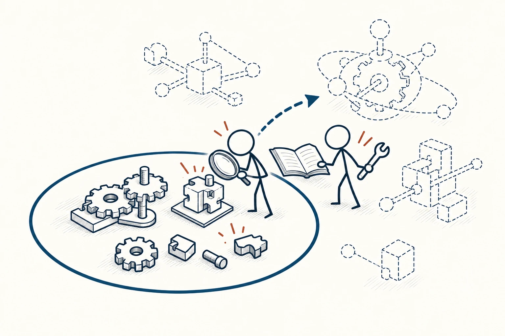
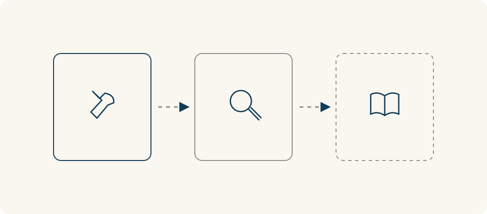

# 17 · 能力圈

Circle of Competence · 认知与推理

> 知道自己真正懂什么，也知道哪些地方还需要求助。

*配图说明：火柴人站在熟悉的机械拼图工作区边界，用放大镜检查已掌握部分；圈外是虚线陌生装置与求助、学习入口，强调判断能力而非控制范围。*

## 定义

朋友让你评价一个方案，你能看懂里面的数据整理，却不熟悉视觉设计。你很想给出完整答案，但“每句话都能读懂”和“有能力判断它靠不靠谱”，并不是同一件事。能力圈提醒我们先分清自己的判断边界。

能力圈是一种判断边界的框架，强调识别自己能够可靠理解和评估的领域，并区分熟悉、真正掌握与尚不了解的部分。

圈内不是你喜欢的所有话题，而是经过学习、实践和反馈，能够解释关键原因、识别常见问题，也知道什么证据可能推翻自己判断的地方。听过很多术语、看过几个案例，未必已经进入圈内。

圈外也不是永远不能碰。可以先找有经验的人核对，选风险较小的任务练习，观察自己是否越来越能独立判断。成长不是把边界画得越来越自信，而是让理解和实际能力一起向外扩展。

圈图可以区分能解释依据的部分、仍需核对的边界和暂时不了解的部分。距离只是帮助整理，不是能力测量分数，也不表示圈外的东西永远不能学。

## 举个身边的例子

你擅长整理表格和检查数据，团队请你审一个新产品方案。你能指出统计口径不一致，也能解释某个结论缺少数据支持；但你从没做过交互测试，不确定用户是否看得懂页面。

可以明确说：“数据部分我能核对，操作体验还需要用户试用或请有经验的人看。”接着参与一次测试，记录自己原先的判断和实际表现有什么差异。这样的分工让意见更可靠，也给了你学习的入口，不必为了显得全面而对所有部分都下结论。

*三块区域依次表示：有实践依据、需要进一步核对、需要学习或求助。它们帮助标明判断边界，不是给能力打固定分数。*

## 换个场景看看

你常给朋友推荐自己长期用过的软件，但第一次接触陌生工具时，不能只看界面漂亮就保证它一定好用。可以先试一两个真实任务，检查功能限制，再把“我实际验证过”和“我暂时猜测”的部分分开。

表达边界不会让建议失去价值。别人反而更容易知道哪些可以直接参考，哪些需要自己再核实。

## 可以这样试

**什么时候用得上：** 准备评价陌生方案、接受新任务，或发现自己虽然能说很多，却解释不清关键依据时。

1. 把当前问题拆开，标出自己做过、验证过的部分，以及只是听过或推测的部分。
2. 对不熟悉且影响较大的部分，先补信息、请教或交给合适的人，不用一个自信态度覆盖全部。
3. 选一项小任务练习，留下事前判断与事后反馈，用实际表现逐步调整能力边界。

## 别用过头了

能力圈不是给自己贴“我不行”的标签，也不是把没兴趣当作不懂的证据。经验会过时，圈内判断也需要核对。它关注“我理解得够不够”，控制圈关注“我能直接决定或影响什么”，两者不能混成同一张圈。

## 花一分钟试试

选一件你最近要给意见的事，列三栏：“能解释依据”“需要核对”“需要求助”。对最后一栏写出一个可以请教的人或可查证的来源。

## 顺着看下去

- [84 · 控制圈](006.md)
- [11 · 权威偏差](019.md)
- [94 · 优势思维](074.md)

## 来源与延伸

- [伯克希尔·哈撒韦 · 1996年股东信中的能力圈](https://www.berkshirehathaway.com/letters/1996.html)

---

例子为方便理解而设置，不是真实案例报道。
