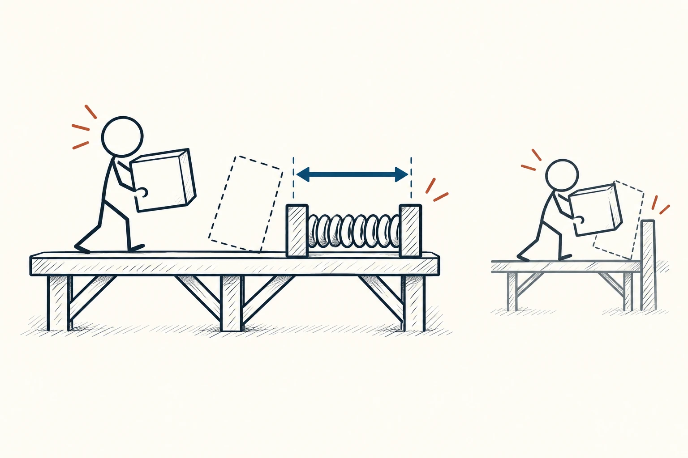
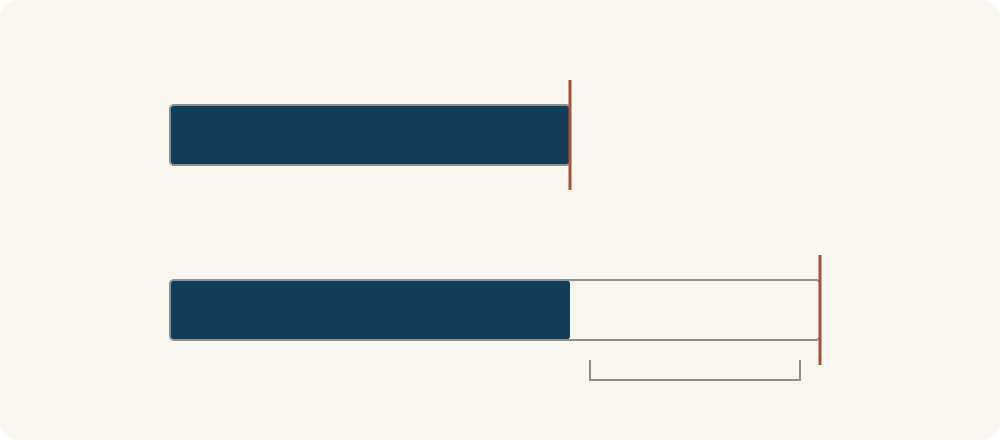

# 41 · 安全边际

Margin of Safety · 选择与决策

> 别把计划排得刚刚好，给意外留一点余地。

*配图说明：火柴人携带方块通过有额外宽度和支撑的简洁桥面，旁边淡淡对照是没有腾挪空间的平台；留白与间距箭头表现缓冲。*

## 定义

一场会议十点开始，你按导航显示的三十分钟车程，九点半才出门。如果红灯多一点、入口不好找，原本“正好够用”的安排就可能立刻不够。安全边际关心的是：当估计不完全准确时，计划还有没有转圜空间。

安全边际指在估计需求与可用资源、预期条件与承受上限之间保留缓冲，以减轻估计误差和意外变化造成的影响。

它可以是时间余量、备用文件、可替换的人手，也可以是系统没有一直顶着上限运行的空间。保留缓冲需要付出一些成本，但能减少小变化立刻变成大麻烦的机会。

重点不是凡事都多留一倍，而是看误差有多大、出错后果有多重、能不能及时补救。常规小任务和难以重来的安排，所需余量可能很不一样。

对比图里可以固定预计需求，再画出不同的可用资源上限。需求与上限之间的空隙代表余量；它是有成本的准备，不是证明任何一种安排都绝对安全。

## 举个身边的例子

你要做一次线上演示，预计讲解十五分钟，安排却只留十五分钟，文件也只有一份在线版本。现场只要登录慢一点、有人提问，就容易超时；网络不稳时，材料也可能打不开。

可以先试讲，看真实用时，再留一点提问和切换时间，同时准备离线文件与简短版本。这里的缓冲针对具体风险，不是无止境加时。演示后记录哪里真正用上了余量，下次再调整，而不是永远凭感觉加一个固定比例。

*深色部分是相同的预计需求，右端标记表示可用资源上限。下方保留空隙作为缓冲，具体余量仍要结合误差、后果与成本决定。*

## 换个场景看看

小团队排一周任务，如果把每个人每天的时间都填满，一次临时支持就会打乱整周。留出少量处理意外的时段，或明确谁能接手关键环节，会让计划更有弹性。

如果一连几周余量都不够，就应检查工作量与流程，不能把长期超负荷包装成偶尔的意外。

## 可以这样试

**什么时候用得上：** 估计可能有偏差、变化较多，或一次失误很难补救，而计划又几乎没有余地时。

1. 列出计划依赖的关键估计，找出最容易偏离、后果较大的地方。
2. 针对这些地方安排适量余量或备用方案，并比较保留缓冲的成本。
3. 事后检查实际消耗和意外来源，调整余量；对反复出现的问题直接改流程。

## 别用过头了

缓冲越多不一定越好，闲置资源和等待也有成本。安全边际不能替代必要检查，更不能保证没有风险。对于专业设备、结构或安全标准，应按专业要求处理，不能靠自己随便加一点余量代替规范。

## 花一分钟试试

选一个明天的安排，写出“最依赖哪个估计”“偏一点会怎样”“能留什么余地”。选一项成本较小、确实针对风险的准备。

## 顺着看下去

- [76 · 墨菲定律](059.md)
- [78 · 收益递减规律](067.md)
- [70 · 帕金森定律](069.md)

## 来源与延伸

- [Farnam Street · 安全边际与意外变化](https://fs.blog/margin-of-safety/)

---

例子为方便理解而设置，不是真实案例报道。
