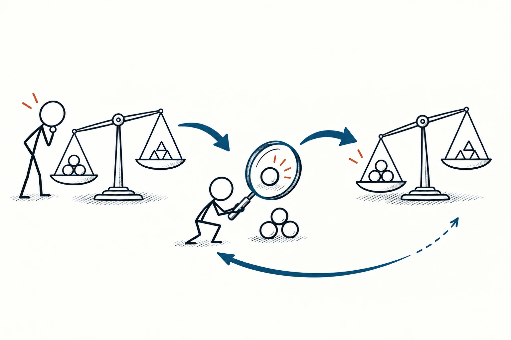
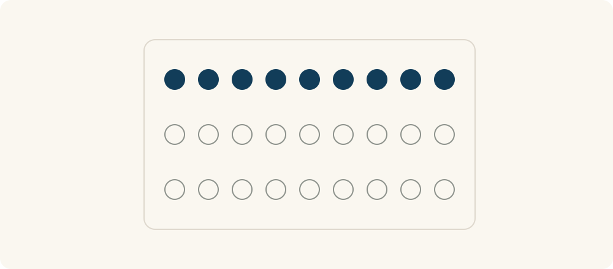

# 26 · 贝叶斯更新

Bayesian Updating · 证据与统计

> 有了新证据，就重新估一估，而不是一口咬死。

*配图说明：火柴人向装有两种解释图形的天平加入经放大镜检查的新证据，右侧天平适度调整但仍保留两种解释，细回路表示继续更新。*

## 定义

你原本觉得一台设备今天出故障的可能性不高，警报响起后，当然要更认真地检查。但警报是否经常误响、真正故障时是否容易漏报，也会影响这条信息有多大分量。新消息不是一出现，就能把“不太可能”直接变成“肯定如此”。

贝叶斯更新是结合原有概率判断与新证据的相对可能性，按照贝叶斯规则得到更新后概率的过程。

贝叶斯更新把几个问题放在一起：原先这种情况有多常见？如果它是真的，看到这条证据有多正常？如果它不是真的，同样的证据又有多容易出现？这些条件共同决定判断应该改动多少。

生活里不一定每次都能算出精确数字，但可以先养成习惯：保留起点，检查证据强弱，再说明自己调整了什么。遇到更好的信息，还能继续修正。

流程图要同时保留原有起点和新证据，不把新消息画成一键得出结论的按钮。证据越有区分力，才越有理由调整；后续信息仍可继续进入流程。

## 举个身边的例子

用一组假设数字看设备警报：100次使用里，约10次有某种异常；系统在这10次里会对9次报警，在其余90次正常使用里也会误报18次。于是27次报警中，约9次真的异常，约占三分之一。

这不是说报警没用：异常的可能性从原先十分之一提高到了约三分之一，值得进一步核查；但也不能只听到“异常时九成都能检出”，就认定一报警有九成可能真出问题。这里的数字只是说明条件概率关系，不是某款设备的真实性能。

*27个报警中，第一排9个深色点表示真正异常，其余18个空心点表示误报。把这27个看完整，才看得出报警后约三分之一异常；仅为假设示例。*

## 换个场景看看

你判断一个新同事是否熟悉某项工作，一次回答不流利可能只是紧张；几次独立任务都能解释清楚、交付也稳定，则提供了不同分量的信息。

不要把同一个传闻被三个人转述，当成三份独立证据。先看信息从哪里来，再决定它能让原判断改变多少。

## 可以这样试

**什么时候用得上：** 需要在不确定中判断，遇到新消息、检测信号或他人评价，想知道是否应该改变原来认识时。

1. 写下原先的判断及依据，尽量找相关的总体情况作为起点。
2. 检查新证据在不同解释下有多常见，注意误报、遗漏和信息是否重复。
3. 据此调整判断，保留不确定性；重要问题继续核实，并允许后续证据再次修正。

## 别用过头了

输入的概率不可靠，算得再细也不会自动变准确。独立性、样本代表性和条件变化都可能影响结果。它不是给任何主观看法随便配个数字的装饰；资料不够时，诚实说明范围和假设，比给出小数点后的精确答案更有用。

## 花一分钟试试

挑一个你最近改变的判断，写出“原先为什么这么想”“哪条新证据改变了我”“这条证据还有没有别的解释”。

## 顺着看下去

- [21 · 第三变量效应](022.md)
- [24 · A/B 测试](025.md)
- [27 · 基准率思维](094.md)

## 来源与延伸

- [OpenStax · 条件概率与贝叶斯定理](https://openstax.org/books/principles-data-science/pages/3-4-probability-theory)

---

例子为方便理解而设置，不是真实案例报道。
