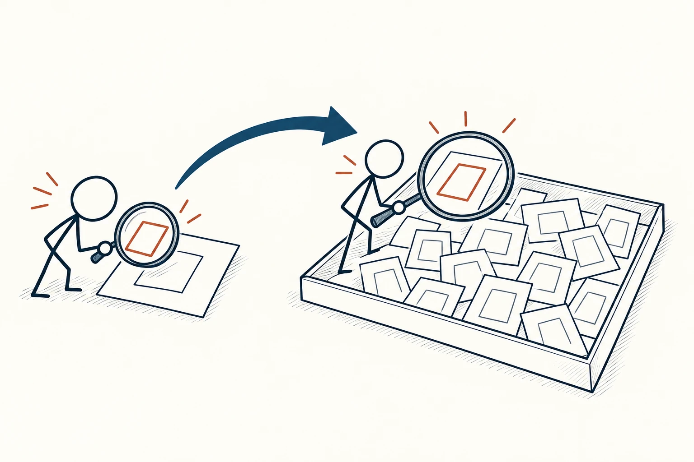
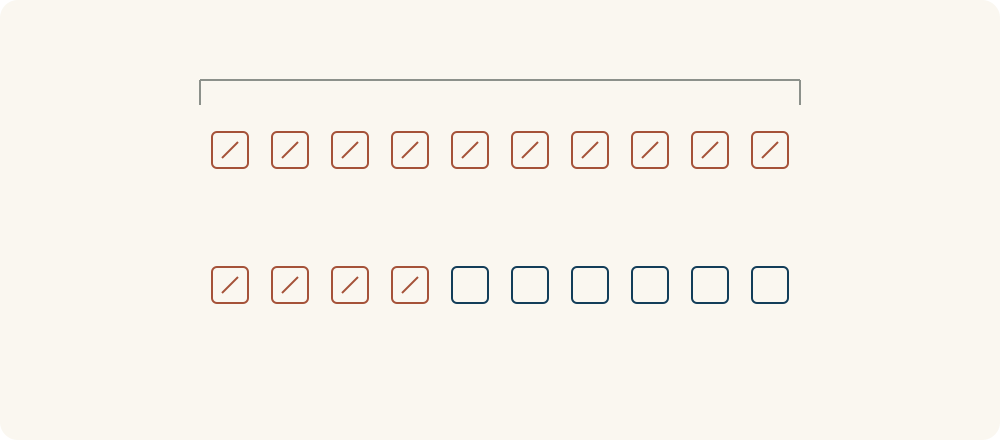

# 27 · 基准率思维

Base Rate Thinking · 证据与统计

> 先看看同类事情通常怎样，再判断眼前这个例子。

*配图说明：火柴人从只盯着一个鲜明案例的放大镜，拉远到包含它的整组可比对象，扩大取景框以看见分母和整体情况。*

## 定义

听到一个人靠某种学习法快速进步，你可能马上觉得自己也会一样。可在跟着做之前，还值得问：试过的人有多少，通常能坚持多久，没达到效果的人又占多少？一个精彩故事，只提供了总体中的一个位置。

基准率思维强调判断个别事件前，先考虑相关参照群体中某种结果的总体比例，并结合个案信息，而不只依赖鲜明故事或局部特征。

基准率给判断提供一个起点。它不要求你把每个人都看成一样，而是先了解同类情况的常见结果，再想眼前案例有哪些真实差异，足不足以改变预期。

参照对象选得合适也很重要。入门者和有经验的人、简单任务和复杂任务，未必适合放在同一个组里。找到看起来精确但条件不同的数据，并不比只听故事可靠多少。

树图从可比的整体出发，再展开不同结果，最后定位当前案例。先把分母画完整，比只把最显眼的案例放大更容易发现缺失的信息。

## 举个身边的例子

你给新项目排期，只觉得“这次准备充分，应该不会延期”。假设团队过去有20个条件接近的项目，其中14个延期，你就需要认真检查这种常见情况背后的原因，而不能只靠这次的信心把它忽略。

接着再看：这次范围是否更小，外部依赖是否减少，过去的审核堵点是否已经处理？如果确有变化，可以调整估计；如果只是大家都很有干劲，历史情况仍然值得作为提醒。这组数字是教学示例，不代表任何真实团队。

*20个假设的相似项目中，14个带斜线的方块表示延期，6个普通方块表示未延期。先看完整分母，再检查当前项目有哪些真实差异。*

## 换个场景看看

你看到一个新工具的用户展示非常漂亮，想把整个工作流程都搬过去。除了看这个案例，还可以找相似工作量、相似能力用户的使用情况，了解完成率、常见障碍和退出原因。

如果没有可比数据，就先承认不确定，做一个小范围试用。基准率思维帮助你补问题，不要求在没有资料时硬编一个总体比例。

## 可以这样试

**什么时候用得上：** 被一个成功或失败故事打动、给项目估时间，或对某件事特别有把握，却还没看过同类情况时。

1. 先定义真正可比的群体，核对任务、时间、经验和条件是否接近。
2. 找总体结果，尤其注意分母、没成功的案例和数据收集方式。
3. 再检查当前个案有哪些有依据的差异，说明为什么要维持或调整起点。

## 别用过头了

总体比例不是个人命运，环境变化也会让旧数据失效。群体划分不合理、样本太小或只留下成功者，都可能误导。它与贝叶斯更新可以配合：前者提醒先找起点，后者进一步讨论新证据怎样改变概率判断。

## 花一分钟试试

找一个最近让你心动的案例，补问三件事：“总共有多少人试过”“相似的人通常怎样”“这个案例有什么可验证的不同”。

## 顺着看下去

- [10 · 幸存者偏差](018.md)
- [22 · 正态分布](023.md)
- [26 · 贝叶斯更新](093.md)

## 来源与延伸

- [MIT OpenCourseWare · 基准率与概率推断](https://ocw.mit.edu/courses/18-05-introduction-to-probability-and-statistics-spring-2022/mit18_05_s22_statistics.pdf)

---

例子为方便理解而设置，不是真实案例报道。
