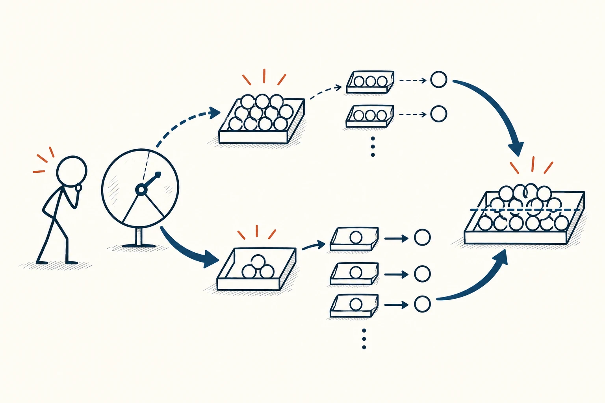
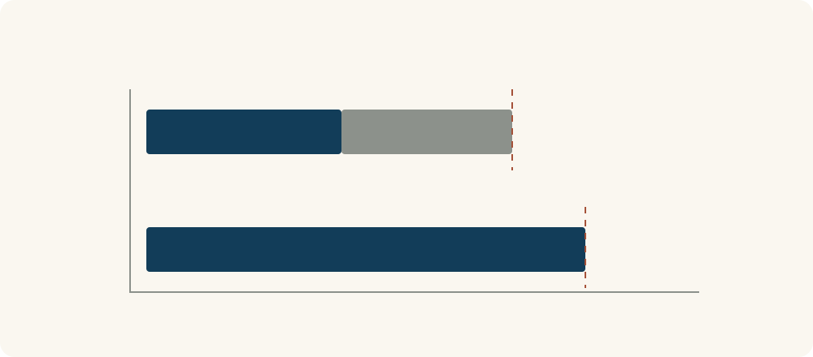

# 42 · 期望值

Expected Value · 选择与决策

> 可能得到多少，要和发生的可能性一起看。

*配图说明：不同粗细的概率分支通向不同大小的结果托盘，多次试验的结果汇入平均水平；火柴人同时查看单次差异与整体。*

## 定义

一条路线通常很快，却偶尔会堵很久；另一条稍慢一些，但时间更稳定。只看最好情况，容易过度乐观；只看最坏情况，又可能忽略平时的表现。期望值提供一种把可能结果与发生概率放在一起比较的办法。

期望值是随机结果按其发生概率加权后的平均值；离散情形下，将每种结果乘以对应概率后相加即可得到。

它不是预测下一次一定出现哪个数，而是在给定概率条件下描述平均水平。某个平均数甚至可能从来不是一次实际结果：一次要么十分钟、要么三十五分钟，平均却可能是十五分钟。

因此，期望值是判断的一部分，还要配合波动、最坏损失、能否重复和自己的限制一起看。一个平均不错的安排，未必适合不能迟到或无法承受一次失败的场景。

分支图要把“可能性”和“结果大小”分开表示，再看各分支的加权贡献。分支长短本身不等于概率，平均位置也不是承诺下一次会落在那里。

## 举个身边的例子

假设路线甲八成情况下用10分钟，两成情况下用35分钟，那么平均用时为10×0.8＋35×0.2＝15分钟。路线乙在这个简化例子里固定需要18分钟。只比较平均时间，甲更短。

但如果你必须20分钟内到达，甲仍有两成机会超过时限，乙反而符合这个假设中的要求。选择依据不只有平均值，还包括“迟到能不能接受”。数字用于演示计算，不代表任何实际道路。

*上方两段分别表示路线甲的加权时间贡献8分钟与7分钟，共15分钟；下方表示路线乙的18分钟。它们是平均比较，不表示甲每次都比乙快。*

## 换个场景看看

你要安排一项反复发生的工作，可以比较不同做法各自花多少时间、多久返工一次。某种操作单次更快，但经常要重来，把返工可能性算进去后，平均成本未必更低。

如果概率只能粗略估计，可以用几个合理范围试算，看结论对假设有多敏感，而不是假装自己知道精确到百分之一的发生率。

## 可以这样试

**什么时候用得上：** 有多个可能结果、能够合理估计发生率，或想比较反复选择下的平均时间、成本与收益时。

1. 列出主要结果与对应概率，确认它们覆盖了需要考虑的情况，且概率相加为1。
2. 把各结果乘以概率后相加，并核对单位是否一致。
3. 再检查波动、极端后果和实际限制，不只按平均数大小作决定。

## 别用过头了

平均值不是保证，也不代表最常见结果。估计错误、结果之间存在依赖、条件随时间变化，都可能让计算失去参考价值。不可承受的损失不能简单被别处的平均好处抵消；面对一次性且影响大的决定，要额外考虑承受范围与可补救性。

## 花一分钟试试

选一件有不确定性的日常安排，列出两三种可能结果及粗略概率。算一次平均，再写出一种会让你不按平均数选择的现实限制。

## 顺着看下去

- [34 · 决策树](049.md)
- [36 · 成本效益分析](051.md)
- [40 · 结果偏差](083.md)

## 来源与延伸

- [OpenStax · 均值、期望值与标准差](https://openstax.org/books/introductory-statistics-2e/pages/4-2-mean-or-expected-value-and-standard-deviation)

---

例子为方便理解而设置，不是真实案例报道。
