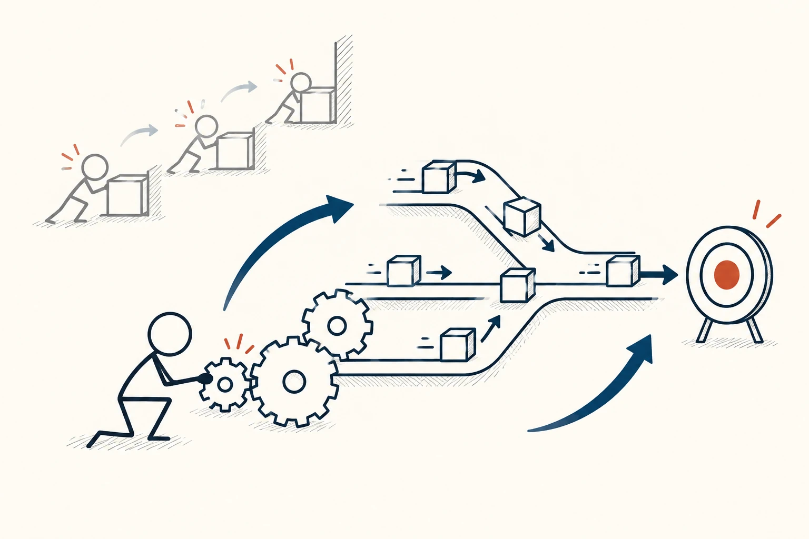
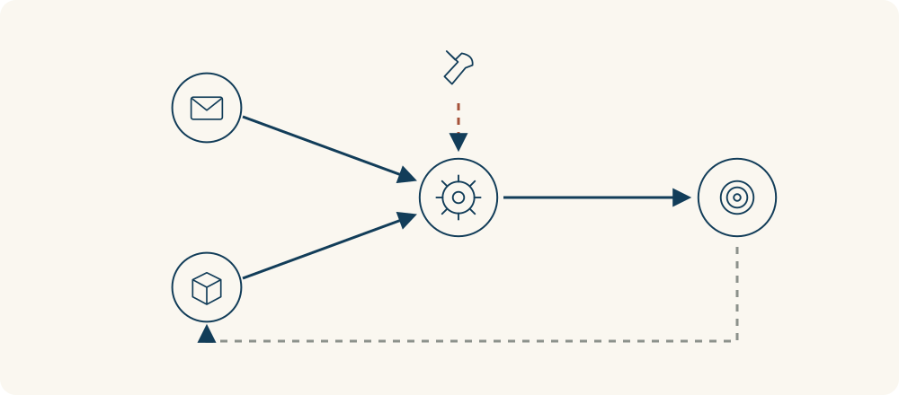

# 82 · 系统杠杆点

Leverage Points · 系统与规律

> 别只忙着处理后果，也看看改哪里能让事情少出问题。

*配图说明：火柴人调整系统里的小规则齿轮，让原本反复堵住的任务方块改变路径；淡淡对照是只推单个方块却没有改变结构。*

## 定义

团队每天都在催同一类任务，你增加提醒次数，短期似乎有点用，过几天又恢复原状。也许问题不在提醒不够，而是任务负责人不清楚、优先级互相冲突，或大家根本看不到下一环节在等什么。

系统杠杆点指在相互关联的系统中，能够对整体行为产生较大影响的干预位置，例如信息流、规则、反馈结构或系统目标。

系统杠杆点提醒我们把目光从单个后果移到产生后果的结构：谁能获得什么信息，怎样分配责任，什么行为被规则鼓励，整个系统到底在追求什么。调整这些地方，可能比不断补救更能改变事情的走向。

但“影响大”不等于“改起来容易”。有些规则需要多人协商，有些调整会带来意外影响。找到一个听起来很根本的原因后，仍然要说明作用路径、试验并观察。

结构图可以把表面问题连接到信息、规则和反馈。标记准备改的那一条关系，再画出预期影响与可能副作用；这些箭头是待验证的解释，不是已经证明的因果链。

## 举个身边的例子

共享资料总是过期，大家每周都要问“最新版本在哪”。你不断在群里重发文件，只能暂时解决眼前寻找的问题。

另一种做法是明确一个固定入口、每份资料的负责人和更新日期，并让旧链接指向当前版本。这些安排改变的是信息怎样流动、谁负责维护。先选一类资料试行，看重复询问、找错版本和维护成本是否减少，再决定是否推广。

*信息、任务和规则共同影响结果。上方工具指向可调整的规则，返回虚线提醒观察后续变化，不能只看一次局部改善。*

## 换个场景看看

会议常超时，主持人每次都催大家讲快点。继续往结构里看，可能是没有提前说明要做哪个决定、谁提供什么材料，导致现场重复补背景。

可以试着把会议目标、必要材料和决定方式提前写清。它不保证每场会都变短，但比把全部责任放在某个人语速上，更有机会找到反复超时的原因。

## 可以这样试

**什么时候用得上：** 同类问题反复发生、补救越来越忙，或怀疑大家被某种规则和信息安排推着做事时。

1. 画出相关的人、信息、规则和反馈，找出问题是怎样被反复产生的。
2. 提出一个可能改变行为的结构调整，说清它通过什么关系影响结果。
3. 从可协商、可观察的小范围开始，检查整体效果与副作用，再决定保留或修改。

## 别用过头了

它不是“找到一个按钮就能解决一切”的保证。系统有延迟、相互作用和外部变化，局部改善也可能把负担转给别人。瓶颈理论重点找限制当前整体产出的约束，杠杆点则更广地讨论改变系统行为的干预位置。

## 花一分钟试试

选一个反复出现的小问题，分别写“我一直在补救什么”和“什么安排让它不断回来”。提出一个可以小范围试验的规则或信息调整。

## 顺着看下去

- [39 · 二阶思维](058.md)
- [77 · 反馈回路](066.md)
- [80 · 瓶颈理论](084.md)

## 来源与延伸

- [Donella Meadows · 系统中的干预位置](https://donellameadows.org/archives/leverage-points-places-to-intervene-in-a-system/)

---

例子为方便理解而设置，不是真实案例报道。
