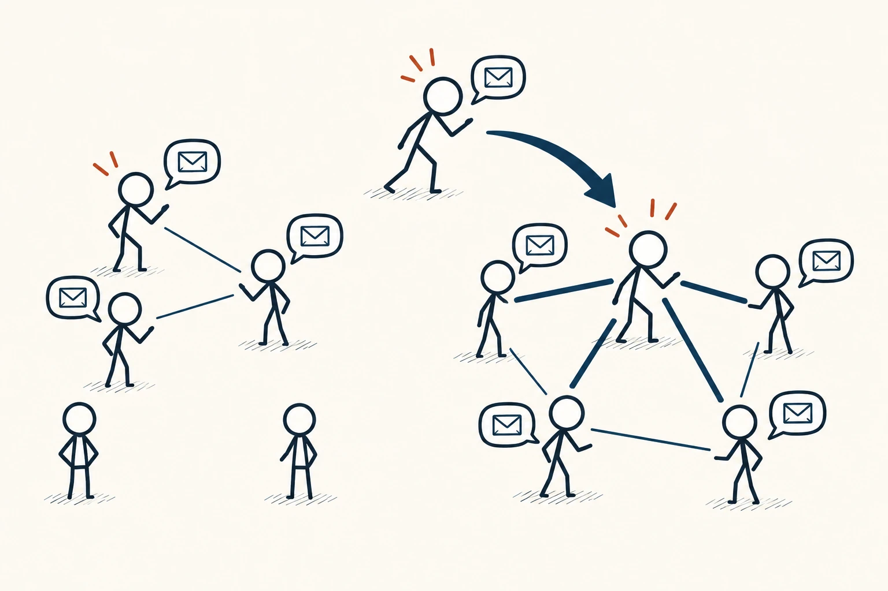
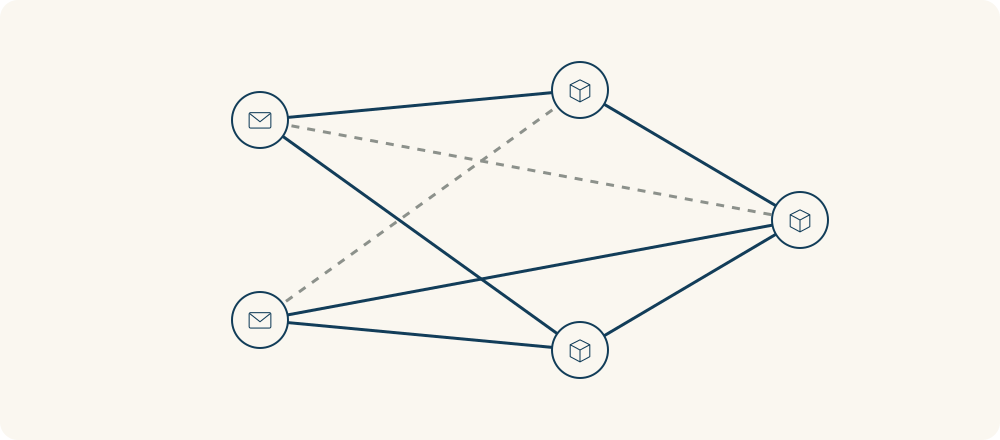

# 83 · 网络效应

Network Effects · 系统与规律

> 有些工具的价值，会随着相关的人一起加入而改变。

*配图说明：左右两组简洁沟通网络，一位兼容的新参与者加入后让已有成员之间增加有用联系；用加粗藏蓝连线表现价值，避免密集人群。*

## 定义

一个聊天工具功能再好，如果你需要联系的人都不在里面，用起来也可能很不方便。等到同事、朋友和合作伙伴都能在同一个地方联系，它对你的用处就变了。这种变化不只来自功能升级，也来自谁和你在同一个网络里。

网络效应指一个产品或服务给用户带来的价值，受到使用它或与之兼容的其他用户数量与结构影响的现象。

关键不只是总人数，而是新增的人能否带来有用连接。一个与你工作完全无关的庞大群组，未必比十个合适的合作伙伴更有价值。某些服务还需要不同角色一起存在，例如有人提供、有人成为使用者。

网络效应也可能遇到限制：人太多后噪声增加、资源拥堵、质量下降，都会影响体验。所以要检查新增连接怎样改变实际用处，而不是把“用户多”直接当成“必然更好”。

网络图把参与者作为节点、有用关系作为连接。可以突出新加入者带来的连接，同时区分无关、拥堵或重复连接；节点更多不自动代表每个人都受益。

## 举个身边的例子

你和两位伙伴选项目沟通工具，原本只看功能清单。后来发现另一个工具虽然功能少一点，却能让合作方直接参与，不必每天来回复制消息，资料也更容易在同一处确认。

这时可以比较：真正需要协作的人是否愿意加入，权限和格式是否兼容，迁移与管理成本有多高。网络带来的便利需要和这些成本一起看，也不能因为很多人在用就忽略自己的具体需求。

*不同节点代表参与者或角色，实线表示有用连接，虚线表示可能增加负担或需要检查的连接。关系的质量与匹配程度，和数量一样值得关注。*

## 换个场景看看

一个物品交换社区，只有发布者没有需要这些物品的人，信息可能很丰富，却很少促成交换。增加合适的参与者，改善搜索与匹配，才可能提高已有成员的使用价值。

如果不断加人只带来广告和无关信息，就要调整规则与组织方式。数量是线索，连接是否有用才是更接近目标的问题。

## 可以这样试

**什么时候用得上：** 选择协作平台、经营社区，或想理解某种服务为什么需要相关的人一起加入才好用时。

1. 先说明用户到底从哪些连接中获得价值，以及需要哪些参与角色。
2. 检查新增参与者能否改善联系、匹配或可获得内容，而不只看总人数。
3. 同时观察噪声、拥堵、兼容与迁移成本，持续核对网络增长是否改善真实体验。

## 别用过头了

不是所有产品都具备明显网络效应，也不能用“连接越多越好”代替分析。网络效应、口碑传播和规模经济是不同概念：传播讲人怎样知道它，规模经济讲平均成本怎样变化，网络效应讲别人的参与怎样影响我的使用价值。

## 花一分钟试试

选一个你常用的群组或工具，写出让它对你有价值的三类连接。再想：多加什么人会更有用，多加什么信息反而会增加负担？

## 顺着看下去

- [75 · 临界规模与引爆点](053.md)
- [79 · 创新扩散曲线](071.md)
- [82 · 系统杠杆点](096.md)

## 来源与延伸

- [CORE Econ · 信息、创新与网络效应](https://books.core-econ.org/the-economy-v1/book/text/21.html)

---

例子为方便理解而设置，不是真实案例报道。
