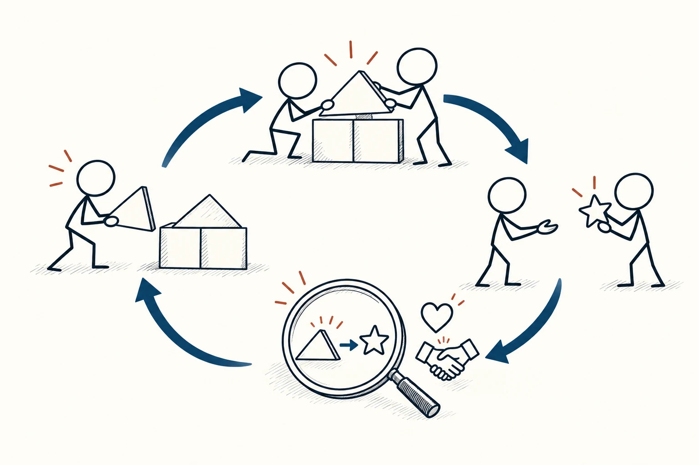
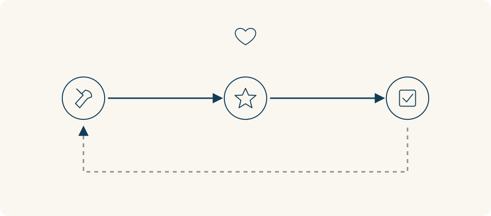

# 61 · 激励机制

Incentives · 伦理与协作

> 想理解人为什么这样做，也看看规则在奖励什么。

*配图说明：两位火柴人完成共享结构，具体有用的贡献与星形认可连接起来；放大镜检查行为与后果之间的联系，旁边保留合作和内在需要的线索。*

## 定义

团队口头说重视协作，实际表扬和分配机会时，却只看个人完成数量。有人因此不愿花时间帮同事，也不一定只是缺少团队精神：他们可能正在回应那套真正起作用的规则。

激励机制是影响行为选择的回报、成本与规则安排，包括物质收益、认可、责任、关系和行为后果等因素。

激励不只是奖金。被看见、得到信任、避免麻烦、保护声誉、拥有选择空间，都可能影响行为。同一个安排对不同的人也可能产生不同作用，所以不能只凭设计者希望什么，就认定大家会怎样回应。

看清激励的目的，是让规则和真正想鼓励的行为更一致，也看见成本由谁承担、好处落到谁身上。不是把人都看成只会追逐利益，更不是寻找操纵别人的按钮。

流程图先画希望发生的行为，再画实际后果，以及人们下一次可能怎样选择。额外标出成本和回报分别由谁承担，才容易发现规则是否把行为带向目标。

## 举个身边的例子

团队希望成员及时分享经验，但分享要整理、演示和回答问题，这些时间却不算进工作安排。大家只能挤自己的空闲时间，久而久之，活动越来越难持续。

可以先确认成员是否有实际需要，再在工作时间里留出位置、认可具体贡献，并减少重复准备。试行后观察分享是否真的帮助别人、参与者负担有没有增加。改变的不是单纯多发一句表扬，而是让付出与回报、责任与资源更能对上。

*从行为到后果，再到下一次选择，检查规则在鼓励什么。上方的心形提醒，兴趣、关系和价值也会影响回应，不能只看外部奖励。*

## 换个场景看看

家里说希望孩子愿意阅读，却每读完一本就只问能拿到什么奖品。外部奖励有时能帮助开始，也可能让注意力逐渐转到奖励上。

可以一起讨论喜欢什么内容、安排自主选择和交流，不把每一次阅读都变成计件任务。这里没有适合所有人的固定奖励方案，需要看具体反应和长期变化。

## 可以这样试

**什么时候用得上：** 规则说的和实际行为不一致、合作总靠少数人额外承担，或准备引入奖励与考核办法时。

1. 写出希望鼓励的具体行为，以及谁要为它花时间、承担成本。
2. 检查当前真正带来回报或麻烦的规则，看看是否和目标一致。
3. 在透明、可协商的前提下小范围调整，观察参与、质量、公平感与长期副作用。

## 别用过头了

人也受价值观、习惯、能力和关系影响，不能把所有行为都解释为算计。奖励可能挤出原有兴趣，惩罚也可能诱发隐瞒。古德哈特定律聚焦指标被追逐后可能失真，激励机制讨论的范围更广，包含不以数字考核呈现的后果安排。

## 花一分钟试试

选一件你希望别人更愿意参与的事，分别写“他要付出什么”“他能得到什么”“现有规则又在鼓励什么”。先找一处可以公平调整的地方。

## 顺着看下去

- [86 · 正强化与负强化](060.md)
- [87 · 内在动机](061.md)
- [81 · 古德哈特定律](085.md)

## 来源与延伸

- [BehavioralEconomics.com · 激励与行为反应](https://www.behavioraleconomics.com/resources/mini-encyclopedia-of-be/incentives/)

---

例子为方便理解而设置，不是真实案例报道。
