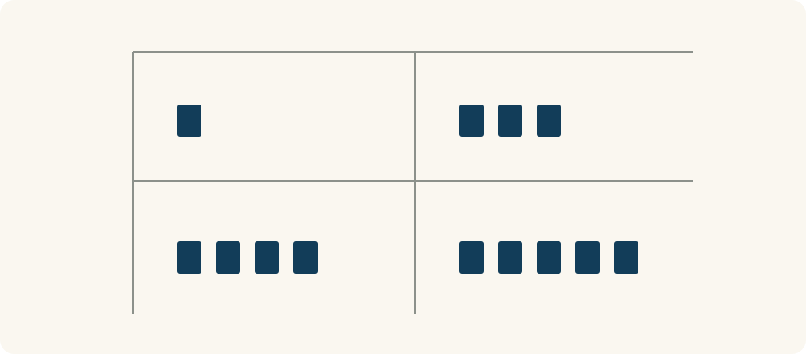

# 62 · 比较优势

Comparative Advantage · 伦理与协作

> 分工不只看谁做得快，还要看各自为此放弃了什么。

*配图说明：两位火柴人面对文档整理与图形设计两类任务，先比较不同沙漏形状，再各自专注一类并交换成果；不把任何一方画成无能。*

## 定义

一个同事做报表快，做海报也快，是不是就该把两种任务都交给他？不一定。除了看谁更快，还要看他把时间花在某一件事上，会放弃多少另一类产出，以及团队怎样搭配更合适。

比较优势指一个人或组织以较低机会成本完成某项活动的相对优势；它不同于完成得更快或用资源更少的绝对优势。

比较优势用机会成本来比较分工。即使一个人在两件事上都慢一些，他仍可能在其中一件事上放弃得相对更少，从而成为合适的协作者。这个“相对”很重要，不是简单地找每个人最喜欢或最自信的工作。

真实团队还要考虑质量、学习、交接、期限和公平，不能只凭一张时间表固定所有人的角色。比较优势提供一个分析角度，不是要求大家永远只做现在最熟的事。

矩阵的行放参与者，列放任务，先保持质量和单位一致。原始用时只能看绝对快慢；比较优势还要把同一人的两类任务作比，算出放弃的另一种产出。

## 举个身边的例子

用一组假设用时：甲做一份报表需1小时、海报需3小时；乙做报表需4小时、海报需5小时。甲两样都更快，但甲做报表只放弃三分之一份海报的机会，乙做报表却放弃五分之四份海报，因此甲在报表上有比较优势。反过来，乙在海报上的机会成本较低。

如果需要两份报表和两份海报，两人各做一份两类任务，总计13人时；让甲做两份报表、乙做两份海报，总计12人时。这只是总劳动时间的简化比较，完成期限还要看能否并行、交接和质量，不能把“更省人时”直接当成“更早交付”。

*上排是甲、下排是乙，左列是报表、右列是海报；每个小块代表1小时。绝对用时按同列比较，机会成本则需要在同一行换算，均为假设数据。*

## 换个场景看看

两位室友分担家务，不能只说“你每件事都比我熟，所以都由你做”。可以比较各自做饭、整理和采购的时间与负担，再讨论分工和交换。

即使某种安排更省时间，也要给双方选择权、练习机会与合理休息。效率收益如果只落在一人身上，合作未必能持续。

## 可以这样试

**什么时候用得上：** 团队或家庭要分工，某人看起来样样更快，或者想理解为什么能力不同的人仍能互相帮助时。

1. 在质量相近的条件下，列出各人完成不同任务的资源和时间。
2. 比较每做一项任务会放弃多少其他产出，区分相对机会成本与绝对速度。
3. 把交接、期限、公平和学习需求一起放进讨论，再试行分工并复盘。

## 别用过头了

它依赖可比较的任务、资源与机会成本，不能随意给一切工作套固定比例。专业质量、协调成本、学习变化和权力差异都可能改变安排。比较优势也不是天生身份，更不能用它合理化让某人长期承担不愿承担的工作。

## 花一分钟试试

选两个人与两类可比较任务，写下大致用时和质量要求。先看谁更快，再单独计算做这一件会放弃多少另一件，看看结论是否相同。

## 顺着看下去

- [29 · 机会成本](009.md)
- [58 · 双赢思维](057.md)
- [94 · 优势思维](074.md)

## 来源与延伸

- [OpenStax · 绝对优势与比较优势](https://openstax.org/books/principles-economics-3e/pages/33-1-absolute-and-comparative-advantage)

---

例子为方便理解而设置，不是真实案例报道。
