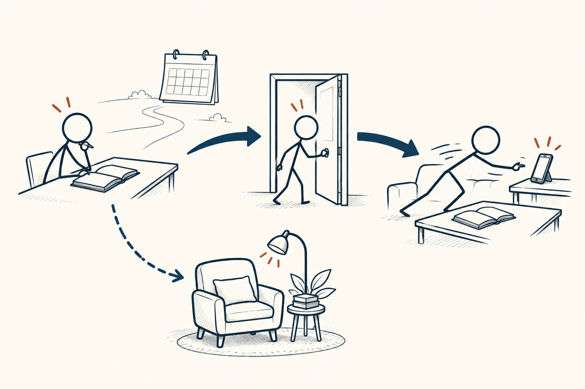
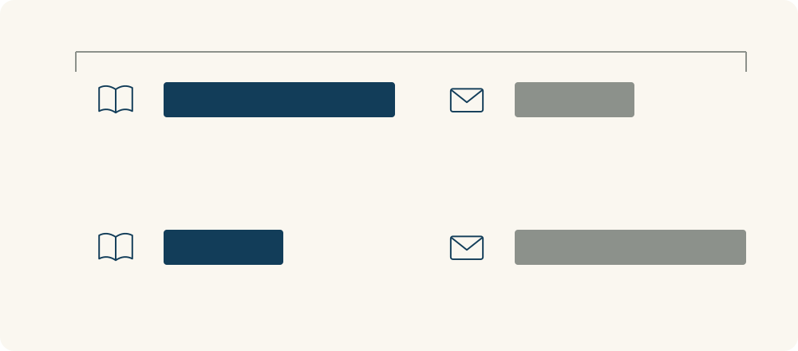

# 100 · 现时偏差

Present Bias · 行为与成长

> 计划时愿意等，真到眼前，却更难拒绝马上舒服一点。

*配图说明：同一个火柴人先在未来日历旁安排阅读，走到实际选择时却被眼前手机拉走；虚线回到预先准备好的阅读位置，表达偏好随即时性改变。*

## 定义

周末安排下周时，你觉得每天读二十分钟很合理。到了某天晚上，书就在旁边，手机却更容易拿起来；你想“明天再认真开始”。计划没有变得毫无价值，只是眼前的轻松和开始的麻烦，突然比几天前更有分量。

现时偏差指相较于两个都在未来的时点，人们在其中一个结果变得即时可得时，对眼前收益或成本给予不成比例权重的倾向。

现时偏差不只是任何喜欢早点得到东西的选择。一个重要线索是偏好会随着“现在”靠近而改变：两件事都还在未来时愿意等，等某个选项马上能得到时，却改变了主意。

理解它后，可以少一点自责，多一点提前安排。把有帮助的动作放得更顺手，减少开始的步骤，给自己一点及时反馈，让计划不只依赖未来那一刻的临场毅力。

对比图分开“还在计划”和“此刻就要选”两个时点。重点观察即时性变化后，注意力与选择是否改变，而不是把任何选择享受的人都画成做错了。

## 举个身边的例子

你周日决定工作日回家先整理五分钟资料，再看视频。周日晚想这件事时不觉得难；周一到家很累，视频立即能带来放松，整理的好处却像是以后才会出现，于是顺序被反复调换。

可以在前一天把待整理材料放到固定位置，只要求先处理一小份，并约定做完就休息。再留意问题到底是眼前诱惑更强，还是工作已经让自己过度疲劳。提前安排环境可以提供帮助，但真实的休息需要也应当被照顾。

*上排示意计划时，下排示意即时选择时；左侧代表目标行为，右侧代表眼前更容易获得的选项。条长只表示权重变化，不是测量数据。*

## 换个场景看看

你答应下周开始处理一个拖了很久的小任务。时间还远时觉得可以，真正到那天又想“再给我一天”。如果条件没有明显变化，这种一再向后移的倾向值得观察。

可以把目标缩到一个具体起步动作，提前约定线索，并在完成后看到一点进展。若任务本身不清楚、资源不足或不再值得做，就直接调整计划，不必把所有拖延都归为一种偏差。

## 可以这样试

**什么时候用得上：** 未来计划总被眼前舒服一点打断，或发现自己还没到执行时很愿意、真到那一刻却反复改主意时。

1. 记录计划时与执行时分别在意什么，确认是否出现了条件不变但偏好改变的情况。
2. 提前降低起步成本，把线索、物品和第一步准备好，让帮助目标的行为更容易发生。
3. 安排适量及时反馈与休息，观察效果；必要时改任务、资源或目标，而不只加重自我要求。

## 别用过头了

选择现在的休息和满足不一定不理性，未来收益也可能不确定。现时偏差不是对所有拖延和改变主意的完整解释，更不是用来评判别人自制力的标签。任何提前约束都应当适度、可理解，避免用过重惩罚伤害自己或他人。

## 花一分钟试试

写一个你常说“明天再做”的小任务。比较计划时和临场时的想法，再选一个今晚就能准备的东西，让明天的第一步更轻一点。

## 顺着看下去

- [87 · 内在动机](061.md)
- [70 · 帕金森定律](069.md)
- [72 · 执行意图](086.md)

## 来源与延伸

- [BehavioralEconomics.com · 现时偏差](https://www.behavioraleconomics.com/resources/mini-encyclopedia-of-be/present-bias/)

---

例子为方便理解而设置，不是真实案例报道。
